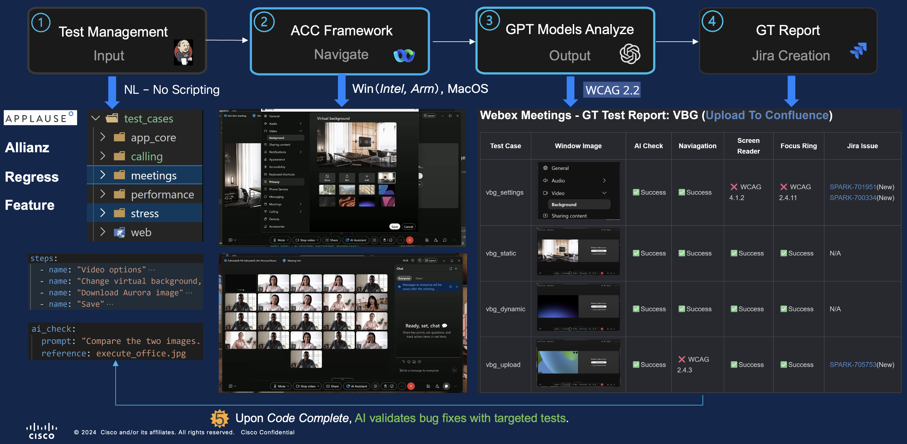
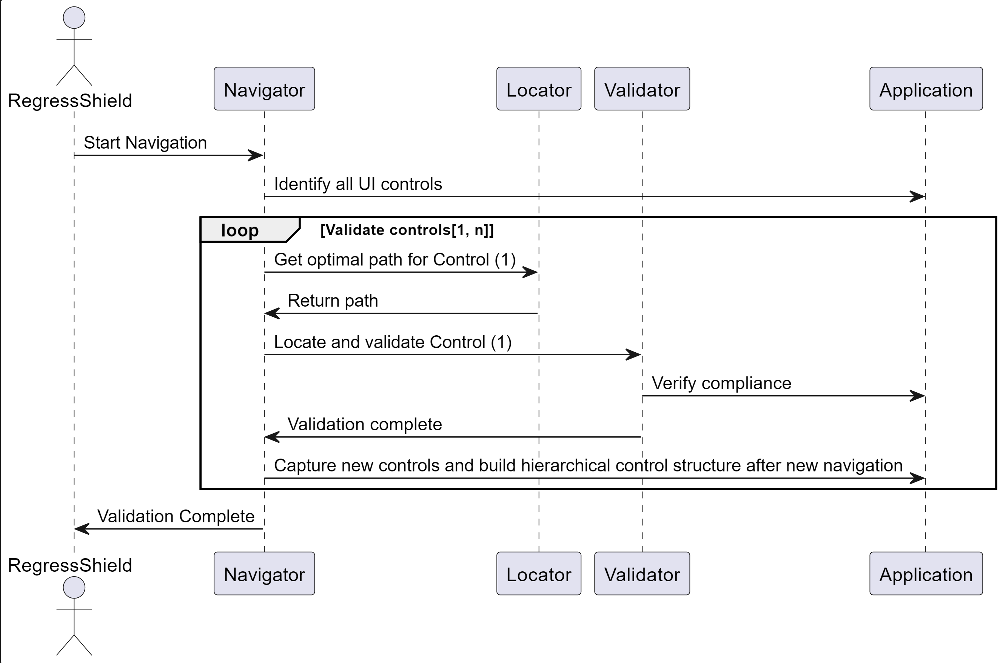

# Introduction

**AI-Powered Accessibility & Quality Automation**  One-click validation across accessibility (A11y), localization (L10n), quality, and performance.



---

## 🚀 Why capabilityX?  

Customers face recurring issues in **accessibility, localization, quality, and performance**.  
Today, **no industry solution** can:  

- Validate the full **meeting workflow** (sign-in → join → background → leave), and ensuring compliance across all key dimensions
- **Automatically detect, file, and re-test bugs** after fixes  
- Provide **cross-platform coverage** with accessibility-first assurance  

**capabilityX fills this gap.**

---

## 💡 Innovation & Technology  

- **WCAG-Based Deep Navigation Algorithm**  
  Ensures compliance through structured, standards-driven exploration.  

- **GPT + Chain-of-Thought Prompting**  
  Enhances reasoning and validation accuracy up to **90%**.  

- **Multi-Platform Support**  
  Unified validation for **Windows, Mac, and Web** applications.  

- **Webex Suite Integration**  
  Seamlessly covers **Meeting, Messaging, Calling**, and more.  

---

## 📊 Impact & Results  

- 🔍 **950+ defects uncovered** across accessibility, quality, and performance  
- 💰 **60% reduction** in manual audit costs  
- ⚡ Faster release cycles with higher confidence  
- 🌎 Setting a new benchmark for **AI-driven, accessibility-first assurance**  

---

## ✅ Key Benefits

- One-click, end-to-end workflow validation  
- Automatic bug lifecycle management (detect → file → re-validate)  
- Reduced costs, improved quality, accelerated time-to-market  
- Scalable to **any application** beyond Webex  

---

## 📋 Quick Start

- [Developer Guide](#developer-guide)
  - [Clone with Submodules](#clone-with-submodules)
  - [Working with Test Cases](#working-with-test-cases)
- [Getting Started](#getting-started)
  - [Installation](#installation)
  - [Test Execution Modes](#test-execution-modes)
    - [Test Suite Mode](#test-suite-mode)
    - [Test Case Mode](#test-case-mode)
    - [Test Batch Mode](#test-batch-mode)
    - [Performance Testing](#performance-testing)
  - [Accessibility AI Automation Skills (Quick Start)](#accessibility-ai-automation-skills-quick-start)
- [Design](#design)
- [Key Features](#key-features)
- [Demo](#demo)
- [Datasets](#datasets)
- [Modules](#modules)
- [Contributing](#contributing)
- [License](#license)
- [Contact](#contact)

---

## Developer Guide

### Clone repo

**Repositories:**
- Main: `git@github.com:capabilityX-LeeVY/capabilityX.git`

```bash
git clone git@github.com:capabilityX-LeeVY/capabilityX.git
```

**Modify test cases:**

```bash
# 0. Pull latest changes
cd capabilityX
git pull origin main

# 1. Navigate to test_space to create test cases
cd src/test_space

# 2. Make changes and commit to submodule
git add .
git commit -m "Add new test case for feature X"
git push origin main

# 3. Create PR to main repo
```

---

## Getting Started

### Installation

capabilityX can be installed using the Universal Visualizer (UV) tool. Ensure you have Python 3.10.11 or later installed on your system.


```bash
pip install uv
```

### **For `Webex native desktop application` on Windows OS**

#### Test Suite Mode

Run a collection of test cases that are executed together to validate a specific feature or functionality of the application:

- To run the test case job for the `video_vbg` test suite.

```bash
uv run python src/run_test_case_job.py --test_suite "video_vbg"
```

#### Test Case Mode

Run a single test case in isolation to validate a specific scenario or functionality of the application:

- To run the `vbg_static` single test case.

```bash
uv run python src/run_test_case_job.py --test_case "vbg_static"
```

- To run the stress test case with keep app option.

```bash
uv run python src/run_test_case_job.py --test_case "stress/test_stress" --keepApp
```

#### Test Batch Mode

Run a batch of independent test cases that can be executed independently without dependencies:

- To run the `video_vbg_batch` test batch.

```bash
uv run python src/run_test_case_job.py --test_batch "video_vbg_batch"
```


### **For `Webex web application` on Windows OS**

**Prerequisites:**

1. Allow microphone and camera permissions for Webex web application in Microsoft Edge browser.
2. If the current test user is logged in, please sign out the test user first.

**Running:**

- To run the test case job for the `web_video_vbg` test suite.

```bash
uv run python src/run_test_case_job.py --test_suite "web_video_vbg"
```

### **For `Webex native desktop application` on Linux OS**

Linux keeps the repository default Python behavior unchanged for other platforms and uses a Linux-only wrapper script to run with system Python 3.12.

**Prerequisites:**

1. Install Python 3.12.
2. Install Linux accessibility modules: `python3-gi` and `python3-pyatspi`.

**Initial setup:**

```bash
./scripts/run_linux_test_job.sh --setup-only
```

**Running:**

- To run the test case job for the `video_vbg` test suite.

```bash
./scripts/run_linux_test_job.sh --test_suite "video_vbg"
```

- To run the `vbg_static` single test case.

```bash
./scripts/run_linux_test_job.sh --test_case "vbg_static"
```

- To rebuild the Linux-only virtual environment before running.

```bash
./scripts/run_linux_test_job.sh --rebuild --test_suite "video_vbg"
```

- To use a non-default Python 3.12 path.

```bash
PYTHON_BIN=/path/to/python3.12 ./scripts/run_linux_test_job.sh --test_suite "video_vbg"
```

### **For `Webex native desktop application` on macOS**

macOS uses a separate `mac_env/pyproject.toml` with Python 3.9.6, because the compiled Mac accessibility modules (`.so` files) require Python 3.9. The main `pyproject.toml` remains unchanged for Windows (Python 3.10.11).

**Prerequisites:**

Install `uv` via Homebrew (recommended — avoids the macOS externally-managed-environment restriction):

```bash
brew install uv
```

**Initial setup (one-time):**

```bash
uv sync --project mac_env/
```

`uv` will automatically download Python 3.9.6 and create an isolated virtual environment at `mac_env/.venv/`.

**Running:**

- To run a single test case:

```bash
uv run --project mac_env/ python src/run_test_case_job.py --test_case "acc_regression/meetings/video/vbg_static"
```

- To run a test suite:

```bash
uv run --project mac_env/ python src/run_test_case_job.py --test_suite "video_vbg"
```

| Platform | Config file | Python | Run command |
|----------|-------------|--------|-------------|
| Windows  | `pyproject.toml` | 3.10.11 | `uv run python src/run_test_case_job.py ...` |
| macOS    | `mac_env/pyproject.toml` | 3.9.6 | `uv run --project mac_env/ python src/run_test_case_job.py ...` |
| Linux    | system Python | 3.12 | `./scripts/run_linux_test_job.sh ...` |


### Accessibility AI Automation Skills (Quick Start)

> ⚠️ Currently supports **Windows** platform only.

Use GitHub Copilot chat (**Agent Mode**) to scan workflows, build control datasets, and create/run test cases — all through natural language.

**Prerequisites:** Open the workspace in VS Code with GitHub Copilot enabled and switch to **Agent Mode**.

#### 1. Getting Started — Discover Available Skills

Type in Copilot chat:

```
run acc automation
```

Copilot will ask you to choose a level:

| Level | What it does |
|-------|-------------|
| **Window** | Keyboard / tab-order check for the current on-screen feature window |
| **Workflow** | End-to-end accessibility scan of a full workflow (sign-in, join meeting, etc.) |
| **Case** | Run an existing test case / suite, or create a new test case |

#### 2. Workflow Scan — Build Control Datasets

A workflow scan navigates through **every window** in a given workflow, collects **all UI controls** and their accessibility metadata (name, role, automation ID, keyboard shortcut, etc.), and builds a structured dataset.

**Example — scan the `sign_up` workflow:**

```
run acc workflow scan on sign_up
```

The scan will:
1. Walk through all windows in the `sign_up` flow
2. Validate every control in each window using keyboard navigation
3. Generate a control metadata dataset and accessibility report

#### 3. Test Cases — Run & Create

**Run an existing test case:**

```
run test case "guest join meeting"
```

```
run test case "show in floating window"
```

**Create a new test case** — describe your test in natural language YAML:

```yaml
name: show_in_floating_window
area: video
pre_conditions: start meeting, open video settings
steps:
  - 1: enable "Show in floating window" checkbox
  - 2: press Escape to close the window
    ai_check: "Verify floating window is applied"
post_conditions: end meeting, sign out
```

> **Tip:** Copilot will search for matching test cases, let you pick from results, and execute automatically. For test case creation, it generates YAML following project conventions and adds it to the appropriate test suite.

> **Note:** Skills use Copilot's built-in agent capabilities, not MCP tool calls. You can also call MCP tools directly (e.g., `call tools to run test suite "video_vbg"`).

---

## Designatures

- 🧭 **Deep Navigation Validation**  
  Validates the navigability of UI elements through keyboard and screen reader traversal. Ensures proper tab order, focus management, and semantic grouping for a fully accessible navigation experience.

- 🧠 **AI-Powered Screen Reader Compatibility**  
  Simulates screen reader behavior using large language models to verify control names, roles, and descriptions. It detects verbose, unclear, or redundant content to ensure that assistive technology users receive accurate and meaningful feedback.

- 🎯 **Focus Ring Detection**  
  Uses computer vision to detect the presence and contrast level of focus rings. This ensures that users navigating with a keyboard can visually identify which element is focused, complying with accessibility design standards.

- 🌍 **Localization Verification (GPT Vision)**  
  Utilizes **GPT-4 Vision** to analyze localized UI screenshots, verifying the correctness, completeness, and cultural appropriateness of translations. It detects issues such as truncated text, layout shifts, and inaccurate or misleading translations across multiple languages.

- 🤖 **Script-Free E2E Testing with Agentic AI Workflow**  
  Implements **MCP** to orchestrate multi-step tasks and simulate realistic user workflows such as login, joining a meeting, or enabling virtual backgrounds. The agent autonomously interacts with the UI, enabling end-to-end functional and accessibility testing without hardcoded scripts.

---

## Design

capabilityX includes an AI agent that follows a structured workflow to analyze and validate UI accessibility. The workflow consists of:


### Step 1: Task Understanding and Reasoning

The user provides a task to the LLM (e.g., GPT), which then analyzes the task and generates reasoning along with actions to complete it.

#### User Input Example

```bash
Ask capabilityX: please help me to anaylze webex meetings controls accessibility
```

#### AI Output Example

```json
{
  "task": "please help me to analyze Webex meetings controls accessibility",
  "Reasoning": {
      "1": "Navigate Webex Meetings interface and identify controls.",
      "2": "Generate Control Dataset.",
      "3": "GPT Analysis of Accessibility Compliance.",
      "4": "Generate Accessibility Report.",
      "5": "Fire Jira Bug for Non-Compliant Controls."
  },
  "actions": {
    "step1": "navigate Webex Meetings interface",
    "step2": "generate control dataset",
    "step3": "analyze control accessibility based on WCAG",
    "step4": "generate accessibility report",
    "step5": "log Jira bug for non-compliant controls"
  }
}
```

### Step 2: Agent Execution

The agent receives the actions generated by GPT and calls the corresponding functions to execute them, such as generating datasets, performing accessibility analysis, and reporting issues.

### Technologies Used

This AI agent leverages several key technologies:

- **Prompt Engineering**: The task is structured in a way that guides GPT to reason and break down steps clearly.
- **Function Calling**: GPT provides structured actions that are mapped to real function calls in the agent.
- **Autonomous Reasoning**: The model performs **multi-step reasoning** to determine the best course of action.
- **Chain-of-Thought (CoT) Prompting**: GPT first reasons about the task before generating actions, improving logical consistency.

## Demo

- [capabilityX Accessibility Demo](https://app.vidcast.io/share/df6d76ca-0ec4-4c53-adff-091819de9073)
- [capabilityX Localization Demo](https://app.vidcast.io/share/567d4b68-5e10-4b82-b3e3-5bc58317f0a3)

---

## Datasets

capabilityX includes a comprehensive dataset designed to support accessibility validation by providing detailed metadata for UI controls. This dataset is automatically generated by AI tools that intelligently traverse the application's UI and capture properties of each control element.

### Dataset Overview

- **Scope**: Currently focused on **Webex Meeting**
- **Total Controls**: 2,600+ individual UI elements collected and annotated
- **Captured Properties**:
  - `description`
  - `automation ID`
  - `control type`
  - `accessibility key`
  - `value`
  - `window name`
  - and more...

This structured dataset serves as the foundation for control identification, navigation, and accessibility validation.

### Example Use Cases

1. **Retrieve Element Properties by Description**  
   Look up properties like `automation ID` using an element’s `description`.  
   Example:

   ```bash
   Fetching AutomationId for description: [AI Assistant], AutomationId: [('Main_CallStripButton_AiAssistant',)]
   ```

2. **Build UI Paths Using Hierarchical Context**  
   Construct precise UI control paths using descriptions or element hierarchy to locate controls.  
   Example:

   ```python
   ['Share', 
    ' Screen or application tab, selected, 1 of 4. Use the left or right arrow keys to navigate between tabs.', 
    ' Share', 
    'More sharing options', 
    'Annotate']
   ```

### Download

You can download the latest version of the dataset here:  
👉 [https://capx.com/datasets/](https://capx.com/datasets/)

This dataset not only enhances the agent’s reasoning capabilities but also enables consistent, programmatic access to UI elements for testing and validation.


## Modules

capabilityX consists of three core modules:

### 1. capabilityX SDK (DeepNaviSDK)

DeepNaviSDK is a Python-based SDK that provides an extensible navigation framework for controlling and interacting with various platforms, including Windows, Mac, Web, and Mobile. It is built using the Factory Design Pattern to ensure flexibility and scalability. The SDK allows developers to extend support for different platforms by implementing platform-specific navigation and control logic.

### 2. capabilityX Core

This module serves as the core of the entire project, encompassing all critical logic. It employs a depth-first algorithm for accessibility navigation to construct the hierarchy of UI controls. The key components include:

- **Navigator**: Responsible for UI control navigation.
- **Locator**: Handles element identification and optimal path generation.
- **Validator**: Ensures the correctness and compliance of UI elements.

#### Core Logic



1. The `Navigator` iterates through the application window, identifying all available UI controls (1, 2, 3... n).
2. A loop determines the number of controls to validate.
3. The `Locator` generates the optimal path to locate the control (1) that needs validation.
4. The `Validator` verifies the control (1).
5. After validating control (1), the `Navigator` performs another iteration to capture new controls generated after interaction (1.1, 1.2, 1.3...).
6. The hierarchical control structure is built as follows:

```markdown
- Control 1
  - Control 1.1
    - Control 1.1.1
    - Control 1.1.2
  - Control 1.2
    - Control 1.2.1
  - Control 1.3
- Control 2
```

- hierarchical control example

```markdown
- Unmute (Ctrl + M), or press and hold the Spacebar to temporarily unmute, button
- Audio options, button
  - Audio Settings..., Menu item
    - Ringers and alerts, combo box
      - All Devices
      - Follow system setting (Speaker (Studio Display Audio) (USB))
```

7.Steps 2-5 are repeated until all controls are validated.

### 3. capabilityX AI Gateway

This module is responsible for interacting with AI models (GPT) to facilitate accessibility validation. It includes functionalities such as:

- Model loading and configuration
- Prompt engineering
- Fine-tuning for specific accessibility checks

The AI Gateway leverages GPT to validate accessibility features such as:

- **Screen Reader Compatibility**
- **Focus Ring Detection**
- **Localization Verification**

---

## 📚 Documentation

### Comprehensive Guides

| Document | Description | Link |
|----------|-------------|------|
| **Architecture Introduction** | Framework architecture overview and system design | [CLAUDE.md](src/docs/CLAUDE.md) |
| **Architecture Design** | Complete framework architecture, directory structure, and design principles | [TESTCASE_ARCHITECTURE_DESIGN.md](src/test_space/docs/TESTCASE_ARCHITECTURE_DESIGN.md) |
| **Creation Guide** | Step-by-step guide for creating test cases with examples | [TEST_CASE_CREATION_GUIDE.md](src/test_space/docs/TEST_CASE_CREATION_GUIDE.md) |
| **Developer Guide** | Development guidelines and best practices | [DEVELOPER_GUIDE.md](src/docs/DEVELOPER_GUIDE.md) |
| **UI Response Time Feature** | UI response time measurement and performance validation | [UI_RESPONSE_TIME_FEATURE.md](src/docs/UI_RESPONSE_TIME_FEATURE.md) |

## Contributing

We welcome contributions! Feel free to submit issues and pull requests to improve capabilityX.

## License

This project is licensed under the MIT License.

## Contact

For any inquiries or support, please reach out to the development team.
