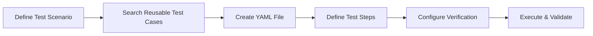

# Test Space - Quick Start Guide

**WebexRegressShield Test Framework** provides a comprehensive test automation solution supporting three execution modes: **Test Case**, **Test Batch**, and **Test Suite**. This framework ensures both atomicity and reusability of test cases while supporting complex scenario combinations and validations.

---

## 📋 Table of Contents

1. [Quick Start](#section-quick-start)
  - [Test Suite Mode](#test-suite-mode)
  - [Test Case Mode](#test-case-mode)
  - [Test Batch Mode](#test-batch-mode)
  - [Run with Specific Account (`--account`)](#run-with-specific-account)
  - [clearupAllversions (`--cleanupAllVersion`)](#clearupallversions)
  - [Customize build version to run the test case or test suite](#customize-build-version-to-run-the-test-case-or-test-suite)
  - [Auto Run on New Build (`onNewVersion`)](#auto-run-on-new-build)
  - [Report Delivery to Webex Rooms](#report-delivery-to-webex-rooms)
2. [Directory Structure](#section-directory-structure)
3. [Test Execution Modes Explained](#section-test-execution-modes-explained)
4. [Creating Test Cases](#section-creating-test-cases)
5. [Documentation](#section-documentation)
6. [Support](#section-support)

---

<a id="section-quick-start"></a>

## 🚀 Quick Start

### Prerequisites

Ensure you have the WebexRegressShield environment set up with Python 3.10.11 or later.

### Test Suite Mode

Run a collection of test cases in a single session to verify multiple features:

```bash
uv run python src/run_test_case_job.py --test_suite "video_vbg"
```

**Use Cases:**
- Verify audio + video + share in one meeting
- Blue channel promotion verification
- Feature integration testing
- Quick smoke testing

**Characteristics:**
- Verify multiple features in one meeting/session
- Share the same test environment (no repeated installation and login)
- Optimize execution time

---

### Test Case Mode

Run a single test case in isolation to validate a specific scenario:

```bash
uv run python src/run_test_case_job.py --test_case "vbg_static"
```

**Use Cases:**
- Testing individual features
- Debugging specific scenarios
- Running atomic operations or complete workflows

**Characteristics:**
- Can be a single atomic operation
- Can be a complete business workflow
- Supports pre-conditions and post-conditions

---

### Test Batch Mode

Run a batch of independent test cases with complete workflows:

```bash
uv run python src/run_test_case_job.py --test_batch "video_vbg_batch"
```

<a id="run-with-specific-account"></a>

### Run with Specific Account (`--account`)

Use `--account` to run a test with a specific predefined account, for example `--account "allianz2"`.

**Important rule:**
- The account value must already be defined in `src/config/account.json`.
- If --account is not provided, the framework uses the account defined in the test case. If --account is provided but is not defined in src/config/account.json, the framework falls back to the account defined in the test case.

**Example:**

```bash
uv run python src/run_test_case_job.py --test_case "vbg_static" --account "allianz2"
```

<a id="clearupallversions"></a>

### Force Download Latest Build (`--cleanupAllVersions`)

Use `--cleanupAllVersions` when you want the framework to always download and install the latest available build.

**How it works:**
- With `--cleanupAllVersions`: the framework clears existing cached versions, downloads the latest build, and installs it.
- Without `--cleanupAllVersions`: the framework first checks the local `download` directory for the latest version. If the same version already exists locally, it reuses that build and skips the download.

**Recommended usage:**
- Use this flag when you want a clean installation from the newest build source.
- Omit this flag when you want to avoid unnecessary downloads and reuse the latest locally cached build.
- **The versions of Qt 6 and Qt 6.8 are the same. Before running builds with different Qt versions, a clean step must be performed first.


**Example:**

```bash
uv run python src/run_test_case_job.py --test_suite "video_vbg" --cleanupAllVersions
```


### Customize build version to run the test case or test suite

```bash
uv run python src/run_test_case_job.py --test_suite "video_vbg" --version "latest" #run suite with latest build
```

```bash
uv run python src/run_test_case_job.py --test_suite "video_vbg" --version "eft" #run suite with release build
```

```bash
uv run python src/run_test_case_job.py --test_suite "video_vbg" --version "46.4.0.34319"  #run suite with "46.4.0.34319"  build
```

```bash
uv run python src/run_test_case_job.py --test_suite "video_vbg" --qtversion "6.8"  #run suite with qtversion "6.8" 
```

```bash
uv run python src/run_test_case_job.py --test_suite "video_vbg" --version "46.4.0.34319" --qtversion "6.8"  #run suite with "46.4.0.34319" build and qtversion "6.8". Only a specific build version from the latest release can be customized
```

<a id="auto-run-on-new-build"></a>

### Trigger upon New Build (`onNewVersion`)

Use `--onNewVersion` to make scheduled jobs run only when a new app build is detected.

**How it works:**
- Configure `--onNewVersion` in Jenkins job command.
- Set the Jenkins job to run hourly (or any periodic schedule).
- When the job starts, the framework checks for the latest build version.
- If a new build is available, the job continues and executes tests.
- If no new build is found, the job exits early (`sys.exit(0)`), and the run is effectively auto-canceled (no test execution is performed).

**Supported execution modes:**
- `test_case`
- `test_suite`
- `test_batch`

You can use `--onNewVersion` with any of the three run modes above.

**Scope limitation:**
- `--onNewVersion` check is only applied when build version is `latest` or `eft`.
- It does not apply to fixed version runs such as `46.4.0.34319`.

**Jenkins command example:**

```bash
uv run python src/run_test_case_job.py --test_suite "video_vbg" --version "latest" --onNewVersion
```

```bash
uv run python src/run_test_case_job.py --test_suite "video_vbg" --version "eft" --onNewVersion
```

```bash
uv run python src/run_test_case_job.py --test_case "vbg_static" --version "latest" --onNewVersion
```

```bash
uv run python src/run_test_case_job.py --test_batch "video_vbg_batch" --version "eft" --onNewVersion
```

### Report Delivery to Webex Rooms

Test reports can be delivered to one or multiple Webex rooms, based on platform defaults, YAML config, or command-line override.

**Default rooms:**
- Windows cases: `c0af0ac0-772f-11ef-9431-6382b932281b`
- Mac cases: `a83fa300-818d-11f0-9d5c-fb6fa60d4c49`
- `promote_blue_channel` (Windows + Mac reports): `74988770-ca6b-11f0-b2ff-8d13d1d24d2e`

**Define multiple room IDs in YAML (`message_room`):**

```yaml
test_case:
  name: Connect to Webex meeting main window (Ensure the meeting window is already open before running this case)
  team: RegressShield
  message_room: ["76295280-183c-11f1-95e9-13602a46d1f8", "f231f590-0729-11f1-867a-0fed11fb7fb9"]
  check_points: ["Keyboard Navigation"]
```

For this test case, a Windows run sends the report to the default Windows room
`c0af0ac0-772f-11ef-9431-6382b932281b` plus all room IDs listed in `message_room`.


`message_room` can be configured in:
- `test_suite`
- `test_case_batch`
- `test_case`

**Priority and scope rules:**
- When running `test_suite`, only `test_suite.message_room` is read.
- When running `test_batch`, only `test_case_batch.message_room` is read.
- When running `test_case`, only `test_case.message_room` is read.
- If both suite/batch and case files define room IDs, suite/batch execution does not read case-level room IDs.

**Command-line override (`--botRoomId`, highest priority):**

```bash
uv run python src/run_test_case_job.py --test_suite "video_vbg" --botRoomId "74988770-ca6b-11f0-b2ff-8d13d1d24d2e"
```

The `--botRoomId` value overrides YAML `message_room` and default room routing for the current run.

**Use Cases:**
- Daily automated regression testing
- Complete verification before version release
- Repeated execution of same workflow to ensure stability

**Characteristics:**
- Each test case is an independent complete workflow
- Each execution includes complete preparation (uninstall, install, sign in)
- Suitable for regression testing and large-scale verification

---

<a id="section-directory-structure"></a>

## 📁 Directory Structure

### Architecture Diagram

```
┌─────────────────────────────────────────────────────────────────┐
│                    Test Execution Modes                         │
├─────────────────────────────────────────────────────────────────┤
│                                                                 │
│  ┌────────────────┐  ┌────────────────┐  ┌────────────────┐     │
│  │   Test Case    │  │   Test Batch   │  │  Test Suite    │     │
│  │   (Atomic Ops) │  │  (Batch Exec)  │  │  (Combined)    │     │
│  └────────────────┘  └────────────────┘  └────────────────┘     │
│         │                    │                    │             │
│         ▼                    ▼                    ▼             │
│  ┌──────────────────────────────────────────────────────┐       │
│  │            Test Case Directory Structure             │       │
│  ├──────────────────────────────────────────────────────┤       │
│  │  1. navigations/        (Atomic Operations)          │       │
│  │  2. acc_regression/     (Complete Workflow)          │       │
│  │  3. release_graduation/ (Release Validation)         │       │
│  │  4. feature_test/       (Feature Validation)         │       │
│  │  5. stress/             (Stress Testing)             │       │
│  │  6. performance/        (Performance Testing)        │       │
│  └──────────────────────────────────────────────────────┘       │
│                                                                 │
└─────────────────────────────────────────────────────────────────┘
```

### Complete Directory Structure

```text
src/test_space/
├── test_cases/                          # Test Case directory
│   ├── navigations/                     # Atomic operations layer
│   │   ├── preconditions/               # Pre-conditions (setup)
│   │   ├── functional/                  # Functional operations
│   │   ├── postconditions/              # Post-conditions (cleanup)
│   │   └── basic/                       # Shared test cases
│   │
│   ├── acc_regression/                  # Complete workflow layer (Accessibility)
│   ├── release_graduation/              # Release validation layer
│   ├── feature_test/                    # Feature validation layer
│   ├── stress/                          # Stress testing layer
│   └── performance/                     # Performance testing layer
│
├── test_batches/                        # Test Batch directory
│   ├── acc_regression/                  # Accessibility regression batches
│   ├── release_graduation/              # Release validation batches
│   └── feature_test/                    # Feature validation batches
│
├── test_suites/                         # Test Suite directory
│   ├── acc_regression/                  # Accessibility regression suites
│   ├── release_graduation/              # Release validation suites
│   └── feature_test/                    # Feature validation suites
│
└── docs/                                # Documentation
    ├── TESTCASE_ARCHITECTURE_DESIGN.md  # Architecture design document
    └── TEST_CASE_CREATION_GUIDE.md      # Test case creation guide
```

---

<a id="section-test-execution-modes-explained"></a>

## 🎯 Test Execution Modes Explained

### Comparison: Batch vs Suite vs Case

| Feature | Test Case | Test Batch | Test Suite |
|---------|-----------|------------|------------|
| **Scope** | Single test scenario | Multiple independent tests | Multiple related tests |
| **Execution** | One atomic/workflow test | Independent complete workflows | Combined in same session |
| **Environment Setup** | Once per test | Full setup for each test | Setup once, shared |
| **Execution Time** | Fastest for single test | Longer (repeated setup) | Optimized (shared env) |
| **Isolation** | High | Very High | Low |
| **Use Case** | Development, Debugging | Regression, Stability | Integration, Quick verify |

---

<a id="section-creating-test-cases"></a>

## ✏️ Creating Test Cases

### Workflow Overview



### Basic Structure

```yaml
test_case:
  name: vbg_static
  description: "Test selecting static virtual background in meeting"
  
  check_points: ["Keyboard Navigation"]

  pre_conditions:
    - navigations/basic/uninstall_app
    - navigations/basic/install_app
    - navigations/preconditions/app_entry/sign_in_to_app
    - navigations/preconditions/app_core/start_meeting

  steps:
    - name: "Video options"
      action:
        type: key
        value: default
      expect_state: ""
    - name: "Change virtual background"
      action:
        type: key
        value: default
      expect_state: "None"
    - name: "Executive office"
      action:
        type: key
        value: default
      expect_state: ""
    - name: "Save"
      platforms: ["windows"]
      action:
        type: key
        value: default
        wait_time: 2
      expect_state: "Video options"
      ui_response: true
      ai_check: 
        prompt: "Compare the two images. The first is the reference virtual background, and the second is a meeting screenshot with a virtual background applied. Ignore any people or foreground elements in the images. Focus only on the background. Determine if the background in the second image matches the reference background in the first. Output format: ✅Success or ❌Failed"
        reference: execute_office.jpg

  post_conditions:
    - navigations/postconditions/end_meeting
    - navigations/postconditions/sign_out
```

### Key Components

- **`pre_conditions`**: Setup actions (reuse from `navigations/`)
- **`steps`**: Core test actions with verification
- **`post_conditions`**: Cleanup actions
- **`check_points`**: Verification dimensions (KB, SR, FR, Performance, L10n)

---

## ️ Test Case Types

### 1. Navigations (Atomic Operations)

**Purpose:** Provide reusable atomic operations

**Examples:**
- `navigations/preconditions/app_entry/sign_in_to_app.yaml`
- `navigations/functional/in_meeting/video/change_virtual_background.yaml`
- `navigations/postconditions/end_meeting.yaml`

### 2. ACC Regression (Complete Workflow)

**Purpose:** End-to-end accessibility validation

**Examples:**
- `acc_regression/meetings/video/vbg_static.yaml`
- `acc_regression/meetings/audio/audio_settings.yaml`

### 3. Release Graduation

**Purpose:** Release validation and smoke testing

**Examples:**
- `release_graduation/smoke_test/basic_meeting_flow.yaml`
- `release_graduation/critical_path/join_meeting.yaml`

### 4. Feature Test

**Purpose:** Feature-specific validation by teams

**Examples:**
- `feature_test/video_team/new_filter_effect.yaml`
- `feature_test/audio_team/noise_cancellation.yaml`

### 5. Stress Testing

**Purpose:** Validate system under extreme load

**Examples:**
- `stress/meetings/concurrent_join_1000_users.yaml`
- `stress/app_lifecycle/repeated_install.yaml`

### 6. Performance Testing

**Purpose:** Monitor system resources and response times

**Examples:**
- `performance/ui_response/vbg_switch_time.yaml`
- `performance/resource_usage/memory_usage.yaml`

---

## 🎨 Check Points

Check points define the verification dimensions for test cases:

| Check Point | Abbreviation | Description |
|-------------|--------------|-------------|
| Keyboard Navigation | KB | All controls accessible via keyboard |
| Screen Reader | SR | Proper ARIA labels, roles, announcements |
| Focus Ring | FR | Visible focus indicators on all controls |
| Performance | Perf | UI response times within acceptable range |
| Localization | L10n | No untranslated or truncated text |

**Usage:**

```yaml
# Full accessibility verification
check_points: ["Keyboard Navigation", "Screen Reader", "Focus Ring", "Performance"]

# Functionality only
check_points: ["Keyboard Navigation"]
```

---

<a id="section-documentation"></a>

## 📚 Documentation

### Comprehensive Guides

| Document | Description | Link |
|----------|-------------|------|
| **Architecture Design** | Complete framework architecture, directory structure, and design principles | [TESTCASE_ARCHITECTURE_DESIGN.md](docs/TESTCASE_ARCHITECTURE_DESIGN.md) |
| **Creation Guide** | Step-by-step guide for creating test cases with examples | [TEST_CASE_CREATION_GUIDE.md](docs/TEST_CASE_CREATION_GUIDE.md) |

### Quick Links

- **Architecture Overview**: Understand the 3 execution modes and 6 test case directories
- **Directory Structure**: Learn how navigations, acc_regression, release_graduation, feature_test, stress, and performance directories work
- **Design Principles**: Single Responsibility, DRY, Reusability, Isolation, Composability
- **Creation Workflow**: 3-step process to create new test cases
- **Test Step Configuration**: Action types, verification options, AI-powered checks
- **Platform-Specific Config**: Handle Windows/Mac differences
- **Best Practices**: Naming conventions, reusability tips, troubleshooting

---

<a id="section-support"></a>

## 🤝 Support

- **Team**: Test Automation Team
- **Repository**: [sqbu-github.cisco.com:binbiwan/wrs_test_space](sqbu-github.cisco.com:binbiwan/wrs_test_space)
- **Main Project**: [sqbu-github.cisco.com:binbiwan/webex-regress-shield](sqbu-github.cisco.com:binbiwan/webex-regress-shield)

---

## 💬 Getting Help

For questions or issues:

1. **Check Documentation**
   - [Architecture Design](docs/TESTCASE_ARCHITECTURE_DESIGN.md) - Framework architecture and design principles
   - [Creation Guide](docs/TEST_CASE_CREATION_GUIDE.md) - Step-by-step test case creation guide

2. **Contact Team**
   - Reach out to the Test Automation Team for technical support

3. **Resources**
   - Browse existing test cases in `test_cases/` directory for examples
   - Review test suites in `test_suites/` for integration patterns

---

## 📊 Version Information

- **Framework Version**: 2.0
- **Last Updated**: January 8, 2026
- **Python Version**: 3.10.11+

---

**Happy Testing! 🚀**
