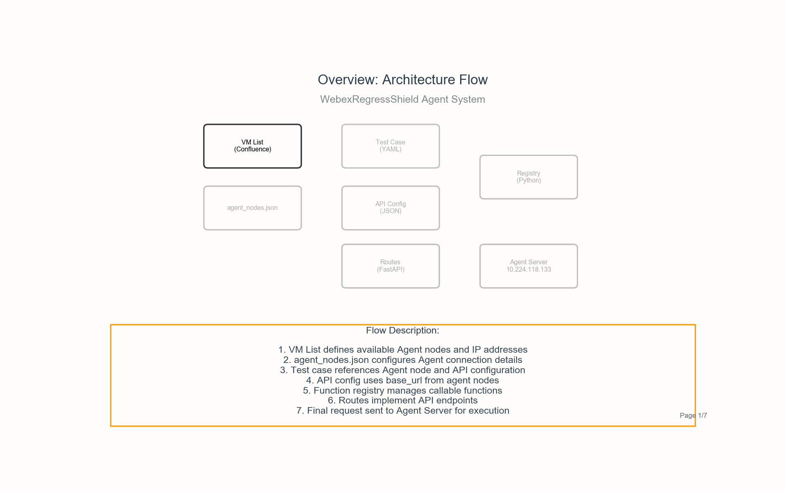

# Remote Agent Case Flow
When test cases use the `api` action type with an `agent_node`, the following interaction flow occurs:

<div style="display: grid; grid-template-columns: 40% 55%; gap: 5%; align-items: start;">

<div>

## Flow Diagram

```mermaid
flowchart LR
    A[🌐 VM List<br/>Confluence] --> B[📋 agent_nodes.json]
    B --> C[📝 Test Case YAML<br/>invite_people_via_agent.yaml]
    C --> D[⚙️ api_config.json]
    D --> E[🔧 registry.py]
    E --> F[🚀 routes.py<br/>FastAPI]
    F --> G[💻 Agent Server<br/>10.224.118.133]
    
    style A fill:#3b82f6,stroke:#1e40af,stroke-width:3px,color:#fff
    style B fill:#6366f1,stroke:#4338ca,stroke-width:3px,color:#fff
    style C fill:#8b5cf6,stroke:#6d28d9,stroke-width:3px,color:#fff
    style D fill:#a855f7,stroke:#7e22ce,stroke-width:3px,color:#fff
    style E fill:#ec4899,stroke:#be185d,stroke-width:3px,color:#fff
    style F fill:#f43f5e,stroke:#be123c,stroke-width:3px,color:#fff
    style G fill:#10b981,stroke:#059669,stroke-width:3px,color:#fff
```



</div>

<div>

## Flow Steps

**1. Get Agent Nodes from**  
https://confluence-eng-gpk2.cisco.com/conf/spaces/WMT/pages/692943834/03.+WRS+VM+list+desktop

- IP: 10.224.118.133
- Node: meeting_agent_01

**2. Configure Agent Connection**

- base_url: http://10.224.118.133:8001

**3. Reference Agent & API**

- agent_node: meeting_agent_01
- value: invite_people_api

**4. Define API Endpoint**

- url: {{base_url}}/api/invite_people
- method: POST

**5. Execute Function**

- Registered function: invite_people
- Returns result to routes

**6. Implement API Endpoint**

- POST /api/invite_people
- Calls registry.execute_function()

**7. Final Execution**

- Run server.py to establish communication
- HTTP Request to agent
- Function executes on agent

</div>

</div>

## Key Components

- **VM List**: Defines available agent nodes and their IP addresses from Confluence
- **agent_nodes.json**: Maps agent node names to connection details (base_url)
- **Test Case (YAML)**: References the agent node and API configuration in the test steps
- **api_config.json**: Defines API endpoints with {{base_url}} placeholder for dynamic URL resolution
- **registry.py**: Function registry that manages and executes the actual test functions
- **routes.py**: FastAPI endpoints that receive HTTP requests and process API calls
- **Agent Server**: Remote machine where the test functions are executed (requires server.py running)

## Example: Agent-Based Test Case

```yaml
test_case:
  name: agent_invite_people
  team: RegressShield
  owner: weiqli
  description: User invites people via agent
  expect_result: Invite people success
  
  steps:
    - name: "Invite people via agent"
      action:
        type: api
        value: "invite_people_api"
        agent_node: "meeting_agent_01"
  
  execution_duration: 1
  execution_count: 1
  check_points: [KB_Navigate]
```

## Configuration Files

**agent_nodes.json:**
```json
{
  "meeting_agent_01": {
    "base_url": "http://10.224.118.133:8001",
    "description": "Meeting agent for video/audio operations"
  }
}
```

**api_config.json:**
```json
{
  "invite_people_api": {
    "url": "{{base_url}}/api/invite_people",
    "method": "POST",
    "headers": {
      "Content-Type": "application/json"
    },
    "body": {},
    "expected_status": 200,
    "timeout": 60,
    "description": "Invite people to meeting via agent API",
    "agent_node": "meeting_agent_01"
  }
}
```

## Visual Demonstration

