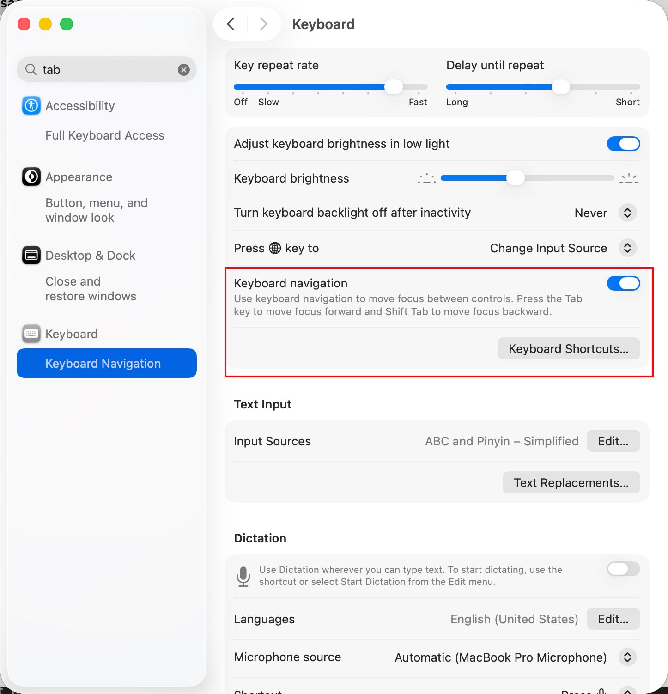
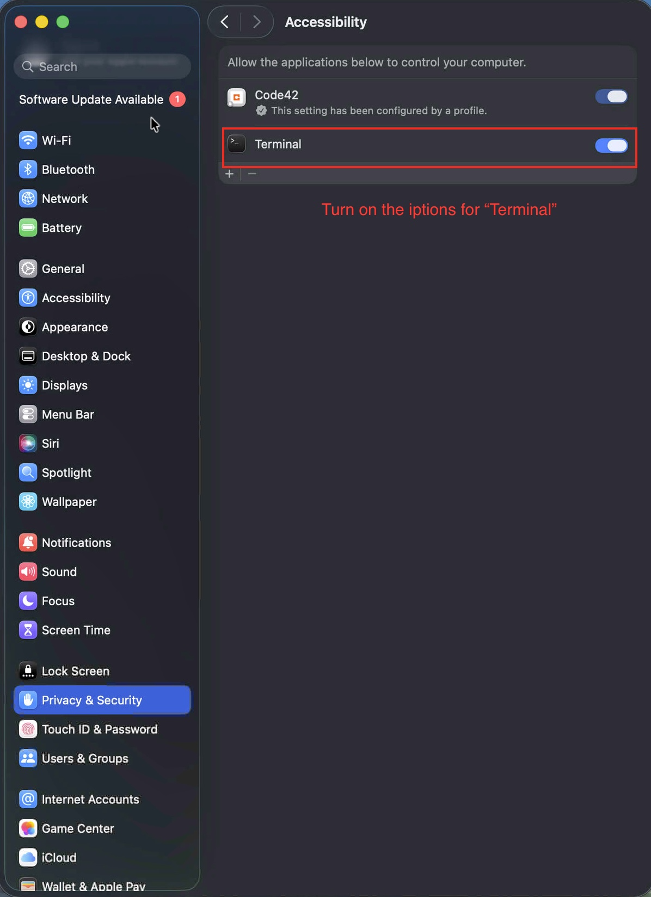
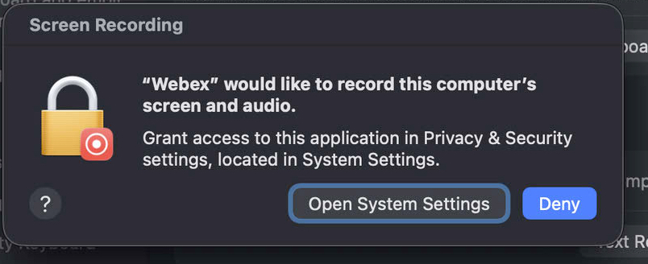
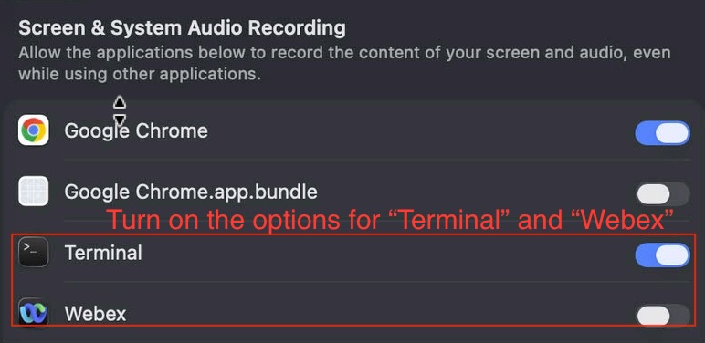

# TEST_AGENT_REGISTRATION

Guide to register a machine as a WRS test agent and connect it to Jenkins.

## Table of Contents

- [Scope](#scope)
- [Prerequisites](#prerequisites)
- [Prerequisites - Windows Dependencies](#windows)
- [Prerequisites - macOS Dependencies](#macos)
- [Prerequisites - macOS Required Permissions](#macos-required-permissions)
- [Required Agent Files](#required-agent-files)
- [Required Agent Files - Windows](#windows-1)
- [Required Agent Files - macOS](#macos-1)
- [Create Jenkins Node and Update Connect Script](#create-jenkins-node-and-update-connect-script)
- [Example command format](#example-command-format)
- [Register Agent](#register-agent)
- [Verification](#verification)
- [Quick Troubleshooting](#quick-troubleshooting)

## Scope

- Supports Windows and macOS.
- This guide is for agent bootstrap only (dependency install + Jenkins connection).

## Prerequisites

### Windows

Install the following tools on a Windows agent machine:


1. **JDK 22**  
     Download link: <https://wrs.qa.webex.com/docs/jdk-22_windows-x64_bin.exe>

2. **Git**  
     Download link: <https://wrs.qa.webex.com/docs/Git-2.50.1-64-bit.exe>

3. **Python 3.10.11**  
     Download link: <https://wrs.qa.webex.com/docs/python-3.10.11-amd64.exe>  
     Important: During installation, enable **Add Python to environment variables**.

4. **Toolhub (optional)**  
     Download link: <https://dlwebex.jabberqa.cisco.com/webextool/>

5. **ManyCam (virtual camera, optional)**  
     Download: <https://wrs.qa.webex.com/docs/ManyCamSetup.exe>  
     Required only if you run VBG-related test cases.

6. **VB-CABLE virtual audio driver (optional)**  
     Download: <https://wrs.qa.webex.com/docs/VBCABLE_Driver_Pack45.zip>

### macOS

Install the following tools on a macOS agent machine:


1. **JDK 22**  
     Download link: <https://wrs.qa.webex.com/docs/jdk-25_macos-aarch64_bin.dmg>

2. **Git**  
     macOS usually includes Git by default. In Terminal, run:
     `git --version`
     If Git is not available, macOS will prompt you to install **Xcode Command Line Tools** (which includes Git). Accept and complete that installation.

3. **Python**  
     Python is usually preinstalled on macOS. 


4. **Toolhub (optional)**   
     Download link: <https://dlwebex.jabberqa.cisco.com/webextool/>

### macOS Required Permissions

Before running test jobs on macOS, enable the following system permissions:

1. **Keyboard Navigation**
     - Open **System Settings** -> **Keyboard**.
     - Turn on **Keyboard navigation**.

2. **Accessibility permission for Terminal**
     - Open **System Settings** -> **Privacy & Security** -> **Accessibility**.
     - Enable **Terminal**.

3. **Screen and system audio recording permissions**
     - If you see the permission dialog:
     
     - Click **Open System Settings**.
     - Go to **Privacy & Security** -> **Screen & System Audio Recording**.
     - Enable both **Terminal** and **Webex**.

## Required Agent Files

### Windows

1. Download `agent.jar`: <https://wrs.qa.webex.com/docs/agent.jar>  Place it in: `C:\Users\<username>\agent.jar`
3. Download Jenkins connect script: <https://wrs.qa.webex.com/docs/connectToJenkins.bat>
4. Place it in: `C:\Users\<username>\connectToJenkins.bat`

### macOS

1. Download `agent.jar`: <https://wrs.qa.webex.com/docs/agent.jar>
2. Place it in: `/Users/<username>/agent.jar`
3. Download Jenkins connect script: <https://wrs.qa.webex.com/docs/connectToJenkins.sh>
4. Place it in: `/Users/<username>/connectToJenkins.sh`

## Create Jenkins Node and Update Connect Script

Before running the connect script, create a dedicated Jenkins node and replace script content with the node-specific command.

1. Open Jenkins: `http://wrs-sm.qa.webex.com:8088/`
     - Login: `jenkins / P@ss1234`
2. Click **Manage Jenkins** (Settings icon) button at the top-right corner to open **Manage Jenkins**.
3. Click **Nodes** under the **System Configuration**.
4. Click **New Node**.
5. Enter a node name in the **Node name** editbox.
6. Select **Copy Existing Node** and input an existing node name (example: `webexRegressSheild-windows-node-alpha`).
7. Click **Create**.
8. Open the new node page and copy the full **Run agent command** line.
9. Replace the content of your local connect script with that copied command:
     - Windows: `C:\Users\<username>\connectToJenkins.bat`
     - macOS: `/Users/<username>/connectToJenkins.sh`

### Example command format

Use the command generated by Jenkins for your node (secret and node name are unique per node).

Windows (`connectToJenkins.bat`): Copy command under **Run from agent command line: (Windows)**

```bat
curl.exe -sO http://wrs-sm.cisco.com:8088/jnlpJars/agent.jar
java -jar agent.jar -url http://wrs-sm.cisco.com:8088/ -secret <NODE_SECRET> -name "<NODE_NAME>" -webSocket -workDir "C:\Users\<username>\"
```

macOS (`connectToJenkins.sh`): Copy command under **Run from agent command line: (Unix)**:

```bash
curl -sO http://wrs-sm.cisco.com:8088/jnlpJars/agent.jar
java -jar agent.jar -url http://wrs-sm.cisco.com:8088/ -secret <NODE_SECRET> -name "<NODE_NAME>" -webSocket -workDir "/Users/<username>/"
```

> Important:
>
> - Do not reuse another machine's `-secret` value.
> - Always use the exact command from your node page.
> - If your Jenkins parser treats node expressions strictly, prefer node names without special symbols.

## Register Agent

### Windows

Run:

```bat
C:\Users\<username>\connectToJenkins.bat
```

### macOS

Run:

```bash
cd /Users/<username>
chmod +x connectToJenkins.sh
./connectToJenkins.sh
```

## Verification

If output contains:

```text
INFO: Connected
```

the agent is registered and connected successfully.

## Quick Troubleshooting

- **`python` not found**: reinstall Python and ensure PATH is enabled.
- **Script permission denied (macOS)**: run `chmod +x connectToJenkins.sh`.
- **Connection failed**: verify network/VPN and Jenkins URL reachability.
- **`agent.jar` not found**: confirm it is in the user home path and script references the same location.

