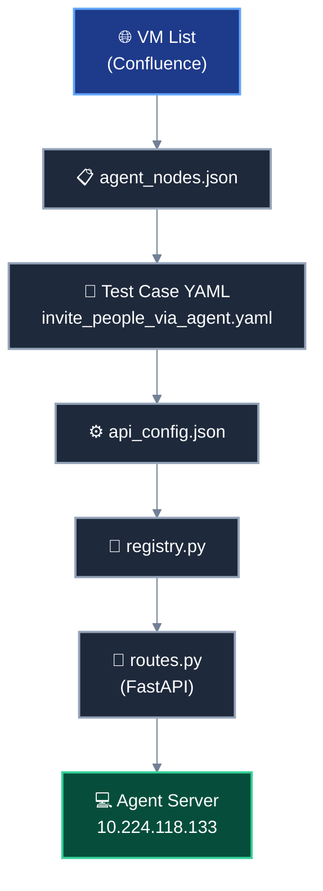

# Test Case Creation Guide

## Overview

This guide provides comprehensive instructions for creating test cases in the WebexRegressShield framework. It covers how to build test case workflows, reuse existing test cases, and configure test steps with various verification options.

**Version:** 1.0  
**Last Updated:** January 19, 2026

---

## Table of Contents

1. [Prerequisites](#1-prerequisites)
2. [Workflow](#2-workflow)
   - [2.1 Test Case Creation Workflow](#21-test-case-creation-workflow)
     - [2.1.1 Example Scenario: Create VBG Static Test Case](#211-example-scenario-create-vbg-static-test-case)
     - [2.1.2 Creation Process Flow Diagram](#212-creation-process-flow-diagram)
     - [2.1.3 Test Step Execution Flow](#213-test-step-execution-flow)
   - [2.2 Step 1: Find Reusable Test Cases](#22-step-1-find-reusable-test-cases)
     - [2.2.1 Search Strategy](#221-search-strategy)
     - [2.2.2 Reusable Test Cases for VBG Static Example](#222-reusable-test-cases-for-vbg-static-example)
   - [2.3 Step 2: Create Test Case YAML File](#23-step-2-create-test-case-yaml-file)
     - [2.3.1 File Location](#231-file-location)
     - [2.3.2 Basic YAML Structure](#232-basic-yaml-structure)
     - [2.3.3 Key Components](#233-key-components)
   - [2.4 Step 3: Define Test Steps](#24--step-3-define-test-steps)
     - [2.4.1 Basic Step Structure](#241-basic-step-structure)
     - [2.4.2 Step with Verification](#242-step-with-verification)
     - [2.4.3 Step with AI Verification](#243--step-with-ai-verification)
   - [2.5 Test Step Configuration Reference](#25-test-step-configuration-reference)
     - [2.5.1 Core Properties](#251-core-properties)
     - [2.5.2 name Property](#252-name-property)
     - [2.5.3 action Property](#253-action-property)
3. [Test Case Configuration Reference](#3-test-case-configuration-reference)
   - [3.1 Action Types](#31-action-types)
     - [3.1.1 Key Action (`type: key`)](#311-key-action-type-key)
     - [3.1.2 Direct key (`type: direct_key`)](#312-direct-key-type-direct_key)
     - [3.1.3 Shortcut Action (`type: shortcut`)](#313-shortcut-action-type-shortcut)
     - [3.1.4 Input Action (`type: input`)](#314-input-action-type-input)
     - [3.1.5 Function (`type: function`)](#315-type-function)
     - [3.1.6 API (`type: api`)](#316-type-api)
       - [Key Components](#key-components)
       - [Example for test case](#example-for-test-case)
       - [Configuration Files](#configuration-files)
       - [Flow Diagram](#flow-diagram)
       - [Visual Demonstration](#visual-demonstration)
   - [3.2 Pre-conditions (`pre_conditions`)](#32-pre-conditions-pre_conditions)
   - [3.3 Post-conditions (`post_conditions`)](#33-post-conditions-post_conditions)
   - [3.4 Verification Options](#34-verification-options)
     - [3.4.1 Expected state (`expect_state`)](#341-expected-state-expect_state)
     - [3.4.2 ui_response](#342-ui_response)
     - [3.4.3 wait_time](#343-wait_time)
     - [3.4.4 ui_response vs wait_time](#344-ui_response-vs-wait_time)
   - [3.5 Execution Duration (`execution_duration`)](#35-execution-duration-execution_duration)
   - [3.6 Execution Count (`execution_count`)](#36-execution-count-execution_count)
   - [3.7 Check Points (`check_points`)](#37-check-points--check_points)
     - [3.7.1 Available Check Points](#371-available-check-points)
     - [3.7.2 Usage](#372--usage)
     - [3.7.3 Recommendation](#373-recommendation)
   - [3.8 AI-Powered Verification (`ai_check`)](#38-ai-powered-verification-ai_check)
     - [3.8.1 Configuration](#381-configuration)
     - [3.8.2 Properties](#382-properties)
     - [3.8.3 Best Practices for AI Verification](#383-best-practices-for-ai-verification)
       - [3.8.3.1 Write Clear Prompts](#3831-write-clear-prompts)
       - [3.8.3.2 Provide Reference Images](#3832-provide-reference-images)
       - [3.8.3.3 Specify Output Format](#3833-specify-output-format)
     - [3.8.4 Use Cases for AI Verification](#384-use-cases-for-ai-verification)
   - [3.9 Platform-Specific Configuration](#39-platform-specific-configuration)
     - [3.9.1 Default Behavior](#391-default-behavior)
     - [3.9.2 Windows-Only Step](#392-windows-only-step)
     - [3.9.3 Mac-Only Step](#393-mac-only-step)
     - [3.9.4 Multi-Platform Differences Example](#394-multi-platform-differences-example)
     - [3.9.5 Available Platforms](#395-available-platforms)
   - [3.10 Complete Example](#310-complete-example)
     - [3.10.1 Workflow Breakdown](#3101-workflow-breakdown)
   - [3.11 Differences Between Test Case, Test Suite, and Test Batch](#311-differences-between-test-case-test-suite-and-test-batch)
4. [Interactive Case Design for Agent-Based Testing](#4-interactive-case-design-for-agent-based-testing)
5. [Best Practices](#5-best-practices)
   - [5.1 Maximize Reusability](#51-maximize-reusability)
   - [5.2 Write Descriptive Names](#52-write-descriptive-names)
   - [5.3 Use Appropriate Check Points](#53-use-appropriate-check-points)
   - [5.4 Provide AI Verification Context](#54-provide-ai-verification-context)
   - [5.5 Handle Platform Differences](#55-handle-platform-differences)
   - [5.6 Use wait_time Appropriately](#56-use-wait_time-appropriately)
   - [5.7 Add Meaningful Verification](#57-add-meaningful-verification)
   - [5.8 Capture Control-Level Screenshot for AI Check](#58-capture-control-level-screenshot-for-ai-check)
   - [5.9 Capture Window-Level Screenshot (Fullscreen)](#59-capture-window-level-screenshot-fullscreen)
   - [5.10 Control Retry on Missing Target Control (`retry_enabled`)](#control-retry)
   - [5.11 Retrieve and Analyze Metrics Data with AI](#511-retrieve-and-analyze-metrics-data-with-ai)
6. [Troubleshooting](#6-troubleshooting)
   - [6.1 Control Not Found](#61--control-not-found)
   - [6.2 How to Find Control Names](#62-how-to-find-control-names)
     - [6.2.1 Windows - Using Inspect.exe](#621-windows---using-inspectexe)
     - [6.2.2 macOS - Using Accessibility Inspector](#622-macos---using-accessibility-inspector)
   - [6.3 expect_state Verification Fails](#63-expect_state-verification-fails)
   - [6.4 AI Verification Returns Incorrect Results](#64-ai-verification-returns-incorrect-results)
   - [6.5 Platform-Specific Step Runs on Wrong Platform](#65-platform-specific-step-runs-on-wrong-platform)
   - [6.6 Pre-condition Test Case Not Found](#66-pre-condition-test-case-not-found)
7. [Additional Resources](#7-additional-resources)
   - [7.1 Related Documentation](#71-related-documentation)
   - [7.2 Quick Reference](#72-quick-reference)
8. [Support](#8-support)

---

## 1. Prerequisites

Before creating test cases, ensure you understand:

- **Test Case Architecture**: Read [TESTCASE_ARCHITECTURE_DESIGN.md](TESTCASE_ARCHITECTURE_DESIGN.md)
- **Directory Structure**: Understand the purpose of `navigations/`, `acc_regression/`, `release_graduation/`, and `feature_test/`
- **YAML Syntax**: Basic knowledge of YAML file format
- **Accessibility Concepts**: Understanding of keyboard navigation, screen readers, and focus ring

---

## 2. Workflow

### 2.1 Test Case Creation Workflow

#### 2.1.1 Example Scenario: Create VBG Static Test Case

**Workflow:**
```
  → uninstall_app 
  → install_app 
  → agree 
  → sign_in_to_app 
  → start_meeting 
  → change_virtual_background 
  → select vbg_static 
  → end_meeting 
  → sign_out
```

This workflow demonstrates a complete test case that verifies the virtual background static image feature with accessibility compliance.

#### 2.1.2 Creation Process Flow Diagram

```mermaid
%%{init: {'theme':'dark', 'themeVariables': { 'primaryColor':'#2d3748','primaryTextColor':'#e2e8f0','primaryBorderColor':'#4a5568','lineColor':'#718096','secondaryColor':'#1a202c','tertiaryColor':'#2d3748'}}}%%
flowchart TD
    Start([🎯 Start: Define Test Scenario]) --> Step1[📋 Step 1: Search Reusable Test Cases]
    
    Step1 --> Search1{🔍 Check<br/>navigations/}
    Search1 -->|✅ Found| Reuse1[➕ Prepare the conditions]
    Search1 -->|❌ Not Found| Create1[🆕 Ask for Key Test Case]
    Create1 --> Reuse1
    
    
    Reuse1 --> Step2[📝 Step 2: Create YAML File]
    Step2 --> Location{📁 Choose<br/>Directory}
    Location -->|Key Workflow| Dir1[📂 acc_regression/]
    Location -->|Release Test| Dir2[📂 release_graduation/]
    Location -->|Feature Test| Dir3[📂 feature_test/]
    Location -->|Atomic Operation| Dir4[📂 navigations/]
    
    Dir1 --> Structure[🏗️ Define YAML Structure]
    Dir2 --> Structure
    Dir3 --> Structure
    Dir4 --> Structure
    
    Structure --> AddMeta[📌 Step 2.1: Add Metadata:<br/>name, description, check_points]
    AddMeta --> AddPre[⚙️ Step 2.2: Configure pre_conditions]
    AddPre --> Step3[🎬 Step 2.3: Define Test Steps]
    
    Step3 --> DefineStep[✏️ Define Step:<br/>name, action, platforms]
    DefineStep --> AddVerify{❓ Need<br/>Verification?}
    AddVerify -->|Yes| AddExpect[✔️ Add expect_state]
    AddVerify -->|No| AddAI
    AddExpect --> AddUI{⏱️ Monitor<br/>Performance?}
    AddUI -->|Yes| SetUI[📊 Set ui_response: true]
    AddUI -->|No| AddAI
    SetUI --> AddAI{🤖 Need Visual<br/>Verification?}
    
    AddAI -->|Yes| ConfigAI[🎨 Configure ai_check:<br/>prompt + reference image]
    AddAI -->|No| MoreSteps
    ConfigAI --> MoreSteps{➰ More<br/>Steps?}
    
    MoreSteps -->|Yes| DefineStep
    MoreSteps -->|No| AddPost[🔧 step 3: Configure post_conditions]
    
    AddPost --> Review[👀 step 4: Review & Validate YAML]
    Review --> Test[🚀 Execute Test Case]
    Test --> Success{✨ Test<br/>Passed?}
    Success -->|✅ Yes| Complete([🎉 Complete])
    Success -->|❌ No| Debug[🐛 Debug & Fix]
    Debug --> Review
    
    style Start fill:#1e4620,stroke:#4ade80,stroke-width:3px,color:#fff
    style Complete fill:#1e4620,stroke:#4ade80,stroke-width:3px,color:#fff
    style Step1 fill:#422006,stroke:#fb923c,stroke-width:2px,color:#fff
    style Step2 fill:#422006,stroke:#fb923c,stroke-width:2px,color:#fff
    style Step3 fill:#422006,stroke:#fb923c,stroke-width:2px,color:#fff
    style ConfigAI fill:#1e3a8a,stroke:#60a5fa,stroke-width:2px,color:#fff
    style Test fill:#4c1d95,stroke:#a78bfa,stroke-width:2px,color:#fff
    style Debug fill:#7f1d1d,stroke:#ef4444,stroke-width:2px,color:#fff
    style Search1 fill:#1e293b,stroke:#94a3b8,stroke-width:2px,color:#fff
    style Location fill:#1e293b,stroke:#94a3b8,stroke-width:2px,color:#fff
    style AddVerify fill:#1e293b,stroke:#94a3b8,stroke-width:2px,color:#fff
    style AddUI fill:#1e293b,stroke:#94a3b8,stroke-width:2px,color:#fff
    style AddAI fill:#1e293b,stroke:#94a3b8,stroke-width:2px,color:#fff
    style MoreSteps fill:#1e293b,stroke:#94a3b8,stroke-width:2px,color:#fff
    style Success fill:#1e293b,stroke:#94a3b8,stroke-width:2px,color:#fff
```




#### 2.1.3 Test Step Execution Flow

```mermaid
%%{init: {'theme':'dark', 'themeVariables': { 'primaryColor':'#2d3748','primaryTextColor':'#e2e8f0','primaryBorderColor':'#4a5568','lineColor':'#718096','secondaryColor':'#1a202c','tertiaryColor':'#2d3748'}}}%%
flowchart TD
    Start([▶️ Step Execution Start]) --> CheckPlatform{💻 Check<br/>platforms<br/>property}
    CheckPlatform -->|✅ Match Current Platform| Locate[🎯 Locate UI Control by name]
    CheckPlatform -->|⏭️ Not Match| Skip([⏭️ Skip Step])
    
    Locate --> Found{🔍 Control<br/>Found?}
    Found -->|✅ Yes| ExecuteAction[⚡ Execute action]
    Found -->|❌ No| Error1([❌ Error: Control Not Found])
    
    ExecuteAction --> WaitTime{⏰ wait_time<br/>specified?}
    WaitTime -->|Yes| Wait[⏳ Wait for specified time]
    WaitTime -->|No| CheckExpect
    Wait --> CheckExpect{✔️ expect_state<br/>specified?}
    
    CheckExpect -->|Yes| StartTimer[⏱️ Start UI Response Timer]
    CheckExpect -->|No| CheckAI
    
    StartTimer --> VerifyFocus[🎯 Verify Focus on Expected Control]
    VerifyFocus --> FocusMatch{🔄 Focus<br/>Matches?}
    FocusMatch -->|✅ Yes| StopTimer[⏹️ Stop Timer]
    FocusMatch -->|❌ No| Error2([❌ Error: Expect State Failed])
    
    StopTimer --> RecordUI{📊 ui_response<br/>= true?}
    RecordUI -->|Yes| LogTime[📈 Log UI Response Time]
    RecordUI -->|No| CheckAI
    LogTime --> CheckAI{🤖 ai_check<br/>configured?}
    
    CheckAI -->|Yes| Capture[📸 Capture Screenshot]
    CheckAI -->|No| Success
    
    Capture --> Reference{🖼️ reference<br/>image exists?}
    Reference -->|Yes| LoadRef[📥 Load Reference Image]
    Reference -->|No| AIVerify
    LoadRef --> AIVerify[🧠 AI Vision Model Verification]
    
    AIVerify --> AIResult{🎨 AI Result:<br/>✅Success or<br/>❌Failed?}
    AIResult -->|✅ Success| Success([✅ Step Success])
    AIResult -->|❌ Failed| Error3([❌ Error: AI Verification Failed])
    
    style Start fill:#1e4620,stroke:#4ade80,stroke-width:3px,color:#fff
    style Success fill:#1e4620,stroke:#4ade80,stroke-width:3px,color:#fff
    style Error1 fill:#7f1d1d,stroke:#ef4444,stroke-width:3px,color:#fff
    style Error2 fill:#7f1d1d,stroke:#ef4444,stroke-width:3px,color:#fff
    style Error3 fill:#7f1d1d,stroke:#ef4444,stroke-width:3px,color:#fff
    style Skip fill:#374151,stroke:#6b7280,stroke-width:2px,color:#d1d5db
    style AIVerify fill:#1e3a8a,stroke:#60a5fa,stroke-width:2px,color:#fff
    style Capture fill:#1e3a8a,stroke:#60a5fa,stroke-width:2px,color:#fff
    style LoadRef fill:#1e3a8a,stroke:#60a5fa,stroke-width:2px,color:#fff
    style LogTime fill:#064e3b,stroke:#34d399,stroke-width:2px,color:#fff
    style ExecuteAction fill:#713f12,stroke:#fbbf24,stroke-width:2px,color:#fff
    style CheckPlatform fill:#1e293b,stroke:#94a3b8,stroke-width:2px,color:#fff
    style Found fill:#1e293b,stroke:#94a3b8,stroke-width:2px,color:#fff
    style WaitTime fill:#1e293b,stroke:#94a3b8,stroke-width:2px,color:#fff
    style CheckExpect fill:#1e293b,stroke:#94a3b8,stroke-width:2px,color:#fff
    style FocusMatch fill:#1e293b,stroke:#94a3b8,stroke-width:2px,color:#fff
    style RecordUI fill:#1e293b,stroke:#94a3b8,stroke-width:2px,color:#fff
    style CheckAI fill:#1e293b,stroke:#94a3b8,stroke-width:2px,color:#fff
    style Reference fill:#1e293b,stroke:#94a3b8,stroke-width:2px,color:#fff
    style AIResult fill:#1e293b,stroke:#94a3b8,stroke-width:2px,color:#fff
```




---

### 2.2 Step 1: Find Reusable Test Cases

**Goal:** Avoid writing duplicate test cases by leveraging existing ones in the `navigations/` directory.

#### 2.2.1 Search Strategy

1. **Navigate to the navigations directory:**
   ```
   src/test_space/test_cases/navigations/
   ├── preconditions/       # Setup actions
   ├── functional/          # Feature operations
   ├── postconditions/      # Cleanup actions
   └── basic/               # Shared test cases
   ```

2. **Check available preconditions:**
   ```
   navigations/preconditions/
   ├── app_entry/
   │   └── sign_in_to_app.yaml          # Sign in action
   └── app_core/
       └── start_meeting.yaml            # Start meeting action
   ```

3. **Check available functional operations:**
   ```
   navigations/functional/in_meeting/
   ├── audio/
   ├── video/
   │   └── change_virtual_background.yaml    # Open VBG panel
   └── share/
   ```

4. **Check available postconditions:**
   ```
   navigations/postconditions/
   ├── end_meeting.yaml                 # End meeting action
   └── sign_out.yaml                    # Sign out action
   ```

#### 2.2.2 Reusable Test Cases for VBG Static Example

| Workflow Step | Reusable Test Case | Location |
|---------------|-------------------|----------|
| Uninstall app | `navigations/basic/uninstall_app` | Basic |
| Install app | `navigations/basic/install_app` | Basic |
| Agree to terms | `navigations/basic/agree` | Built-in |
| Sign in | `navigations/preconditions/app_entry/sign_in_to_app` | Preconditions |
| Start meeting | `navigations/preconditions/app_core/start_meeting` | Preconditions |
| Change VBG | `navigations/functional/in_meeting/video/change_virtual_background` | Functional |
| End meeting | `navigations/postconditions/end_meeting` | Postconditions |
| Sign out | `navigations/postconditions/sign_out` | Postconditions |

**Result:** Only the "select vbg_static" step needs to be created as new test steps.

---

### 2.3 Step 2: Create Test Case YAML File

#### 2.3.1 File Location

Determine the appropriate directory based on the test case type:

| Type | Directory | Example |
|------|-----------|---------|
| Complete Workflow (Accessibility) | `acc_regression/` | `acc_regression/meetings/video/vbg_static.yaml` |
| Release Validation | `release_graduation/` | `release_graduation/smoke_test/basic_flow.yaml` |
| Feature Testing | `feature_test/` | `feature_test/video_team/new_filter.yaml` |
| Atomic Operation | `navigations/` | `navigations/functional/in_meeting/video/select_vbg.yaml` |

#### 2.3.2 Basic YAML Structure

```yaml
test_case:
  name: vbg_static
  description: "Test selecting static virtual background in meeting"
  
  check_points: ["Keyboard Navigation"]

  pre_conditions:
    - navigations/basic/uninstall_app
    - navigations/basic/install_app
    - navigations/basic/agree
    - navigations/preconditions/app_entry/sign_in_to_app
    - navigations/preconditions/app_core/start_meeting
    - navigations/functional/in_meeting/video/change_virtual_background

  steps:
    # Your new test steps go here

  post_conditions:
    - navigations/postconditions/end_meeting
    - navigations/postconditions/sign_out
```

#### 2.3.3 Key Components

- **`name`**: Unique identifier for the test case (lowercase with underscores)
- **`description`**: Clear description of what the test case verifies
- **`check_points`**: List of verification dimensions (see [Check Points](#37-check-points--check_points))
- **`pre_conditions`**: List of reusable test cases to run before main steps
- **`steps`**: Array of test steps defining the core test actions
- **`post_conditions`**: List of cleanup test cases to run after main steps

---

### 2.4  Step 3: Define Test Steps

Test steps define the specific actions and verifications for your test case.

#### 2.4.1 Basic Step Structure

```yaml
steps:
  - name: "Executive office"
    action:
      type: key
      value: default
```

#### 2.4.2 Step with Verification

```yaml
steps:
  - name: "Save"
    platforms: ["windows"]
    action:
      type: key
      value: default
    expect_state: "Video options"
    ui_response: true
```

#### 2.4.3  Step with AI Verification

Use AI to verify test results, particularly useful for visual comparisons. When use ai_check, reference is optional. Reference folder: src\test_space\datasets\img

**Example:**
```yaml
ai_check: 
  prompt: "Compare the two images. The first is a reference virtual background with a dynamic gradient color style (e.g., from purple to black). The second is a meeting screenshot where a virtual background has been applied. Ignore all people or foreground elements. Focus only on the overall color style and gradient pattern of the background. The backgrounds may not be identical due to dynamic variations, but a successful match should have a similar gradient direction, color tone family, and visual blending style. Determine if the second image shows a background that is visually consistent with the reference. Output format: ✅Success or ❌Failed"
  reference: aurora.JPG
```
```yaml
steps:
  - name: "Save"
    platforms: ["windows"]
    action:
      type: key
      value: default
    expect_state: "Video options"
    ui_response: true
    ai_check:
      prompt: "Compare the two images. The first is the reference virtual background, and the second is a meeting screenshot with a virtual background applied. Ignore any people or foreground elements in the images. Focus only on the background. Determine if the background in the second image matches the reference background in the first. Output format: ✅Success or ❌Failed"
       execute_office.jpg
```

---

### 2.5 Test Step Configuration Reference

#### 2.5.1 Core Properties

| Property | Type | Required | Description |
|----------|------|----------|-------------|
| `name` | string | Yes | Name of the UI control to locate via accessibility |
| `action` | object | Yes | Defines the action to perform on the control |
| `platforms` | array | No | Specifies which platforms to run this step on (default: all) |
| `expect_state` | string | No | Expected control name after action completes (for verification) |
| `ui_response` | boolean | No | Record UI response time (time until focus reaches expected control) |
| `ai_check` | object | No | Enable AI-powered visual verification |

#### 2.5.2 name Property

- **Purpose**: Identifies the UI control to locate using accessibility rules
- **Mechanism**: Uses keyboard navigation to find the control by its accessible name
- **Example**: `"Executive office"` locates the "Executive office" virtual background option

```yaml
- name: "Executive office"
```

#### 2.5.3 action Property

Defines the action to perform on the located control.

```yaml
steps:
- name: "Mute"
action:
  type: key              # Action type (key, shortcut, mouse, etc.)
  value: default         # Action value (default = Space key)
  wait_time: 2          # Optional: Wait time after action (seconds)
```

**Properties:**
- **`type`**: Type of action to perform (see [Action Types](#31-action-types))
- **`value`**: Specific value for the action
- **`wait_time`**: Optional delay after action execution (in seconds)

---
## 3. Test Case Configuration Reference

### 3.1 Action Types

The `type` field defines how an action is executed. There are 6 types of actions available.

type: key 
type: direct_key
type: shortcut
type: function
type: api
type: input

#### 3.1.1 Key Action (`type: key`)

Simulates keyboard input.
This is the default action type. It requires locating a control by its name before performing the action. The default value is the space key.

**When to use:** We use `type: key` by default. This type requires you to locate the control name first, then perform the action on it.

**`value` Options:**

| Value | Description | Keyboard Key |
|-------|-------------|--------------|
| `default` | Default activation key | Space |
| `enter` | Enter key | Enter/Return |
| `tab` | Tab key | Tab |
| `esc` | Escape key | Escape |

**Example:**
```yaml
# When Focus is on the "Agree" button, the default activation key is press 'SPACE' key.
name: "Agree"
platforms: ["windows", "mac"]
action:
  type: key
  value: default
```

**Define KEY_MAP in 'src/config/key_map.py':**
```yaml
KEY_MAP = {
    "default": "{SPACE}",
    "space": "{SPACE}",
    "enter": "{ENTER}",
    "esc": "{ESC}",
    "tab": "{TAB}",
    "shift+tab": "{SHIFT}{TAB}",
    "left": "{LEFT}",
    "right": "{RIGHT}",
    "up": "{UP}",
    "down": "{DOWN}",
}
```

#### 3.1.2 Direct key (`type: direct_key`)

Used when you don't need to find a control name. Directly sends a key press.

**When to use:** For direct keyboard input without control location.

**Example:**
```yaml
name: "Direct Escape Key Press"
action:
  type: direct_key
  value: esc
```

#### 3.1.3 Shortcut Action (`type: shortcut`)

Executes predefined keyboard shortcuts. Does not require control name location. Shortcuts must be defined in configuration files:

- **Windows:** Define shortcuts in `shortcut_map.py`
- **macOS:** Define shortcuts in `shortcuts.yaml`

**Example for Shortcut Definition  (Windows):**
```python
SHORTCUT_MAP = {
    "Mute": ["ctrl", "m"],
    "Unmute": ["ctrl", "m"],  
    "Minimize window": ["win", "down"]
}
```
**Example for shortcut:**
```yaml
action:
  type: shortcut
  value: Mute   # Executes Ctrl+m 
```

**Common Shortcuts:**
- `Close Dialog`: Close current dialog (Ctrl+W / Cmd+W)
- `Save`: Save (Ctrl+S / Cmd+S)
- `Copy`: Copy (Ctrl+C / Cmd+C)
- `Paste`: Paste (Ctrl+V / Cmd+V)

#### 3.1.4 Input Action (`type: input`)

Used when you need to input text content (e.g., account names, meeting numbers).
You can either directly write the input content in the `value` field, or pass parameters through `value`.

**When to use:** For text input fields requiring specific values.

**Example with direct value:**
```yaml
action:
  type: input
  value: "test@webex.com"
```

**Example with parameter:**
```yaml
action:
  type: input
  value: "{{email_address}}"  # Pass parameter through value
```

**Note:** Parameters such as login account information can be defined in `src/config/account.json`.
```yaml
   - name: "Email address"
      action:
        type: input
        value: ${email}
      expect_state: ""
```

#### 3.1.5 `type: function`

Used for complex operations that require custom functions (e.g., opening a browser). Functions must be defined in `function.json` located at: `/src/test_space/test_functions/function.json`

**Example for Function Definition:**
```json
{
  "name": "open_browser",
  "description": "Open Microsoft Edge browser and navigate to the specified URL",
  "module_path": "test_space.test_functions.platform_functions.web_functions",
  "function_name": "open_browser",
  "parameters": {
    "type": "object",
    "properties": {
      "site_url": {
        "type": "string",
        "description": "URL to navigate to",
        "default": "https://web.webex.com"
      }
    },
    "required": []
  }
}
```

**Example for Function Usage:**
```yaml
name: "open_browser"
action:
  type: function
  value: open_browser
  parameters:
    site_url: "https://web.webex.com"
```


#### 3.1.6 `type: api`

Used for API-based actions, particularly useful for multi-agent interactions. 

**Key Components**

* VM List: Defines available agent nodes and their IP addresses from Confluence
* agent_nodes.json: Maps agent node names to connection details (base_url)
* Test Case (YAML): References the agent node and API configuration in the test steps
* api_config.json: Defines API endpoints with {{base_url}} placeholder for dynamic URL resolution
* registry.py: Function registry that manages and executes the actual test functions
* routes.py: FastAPI endpoints that receive HTTP requests and process API calls
* Agent Server: Remote machine where the test functions are executed (requires server.py running)


**Example for test case**
```yaml
test_case:
  name: agent_invite_people
  team: RegressShield
  owner: weiqli
  description: User invites people via agent
  expect_result: Invite people success
  
  steps:
    - name: "Invite people via agent"
      action:
        type: api
        value: "invite_people_api"
        agent_node: "meeting_agent_01"
  
  execution_duration: 1
  execution_count: 1
  check_points: [KB_Navigate]
```
**Configuration Files**

***agent_nodes.json:***
```yaml
{
  "meeting_agent_01": {
    "base_url": "http://10.224.118.133:8001",
    "description": "Meeting agent for video/audio operations"
  }
}
```

***api_config.json:***
```yaml
{
  "invite_people_api": {
    "url": "{{base_url}}/api/invite_people",
    "method": "POST",
    "headers": {
      "Content-Type": "application/json"
    },
    "body": {},
    "expected_status": 200,
    "timeout": 60,
    "description": "Invite people to meeting via agent API",
    "agent_node": "meeting_agent_01"
  }
}
```
**Flow Diagram**


**Visual Demonstration**


---

### 3.2 Pre-conditions (`pre_conditions`)

Define prerequisite steps that must be executed before the main test case. These steps are not explicitly verified.
#### 1. Running a Single Case

* When a single test case is executed individually, all cases defined in its Pre-conditions will be executed first.

* The pre-condition cases are executed completely before the main test case starts.

#### 2. Running a Test Suite

* When executing a test suite, the Pre-conditions defined within individual cases are ignored.

* The cases listed in Pre-conditions will not be executed, and the system will directly execute the test cases included in the test suite.

#### 3. Running a Test Batch

* When running cases as part of a test batch, the Pre-conditions of each case will be executed.

* For every case in the batch, its corresponding Pre-conditions are executed prior to running the main case.

**When to use:** For setup actions like signing in, installing the app, or starting a meeting.

**Example:**
```yaml
pre_conditions:
  - navigations/basic/re-install_app
  - navigations/basic/sign_in
  - meetings/actions/start_meeting

```

---

### 3.3 Post-conditions (`post_conditions`)

Define cleanup steps that should be executed after the test case completes.
The execution rules for cases defined in Post-conditions are the same as those for Pre-conditions.

**When to use:** For teardown actions like ending a meeting or signing out.

**Example:**
```yaml
post_conditions:
  - meetings/actions/end_meeting
  - navigations/basic/sign_out
```


---
### 3.4 Verification Options

#### 3.4.1. Expected state (`expect_state`)

Verifies that the focus moves to the expected control after the action. 

**Purpose:**
- Validate that the action succeeded
- Ensure proper focus management
- Verify accessibility compliance

**Best Practice:** 
The expect_state result can be a single name, multiple names in an array, or an ID.

**Example:**
```yaml
- name: "Save"
  action:
    type: key
    value: default
  expect_state: "Video options"  # After clicking Save, focus should be on "Video options"
```

**Behavior:**
- ✅ **Success**: Focus is on the control named "Video options"
- ❌ **Failed**: Focus is on a different control or lost

#### 3.4.2. ui_response

Records the UI response time from action execution to focus arrival at the expected control.

**Purpose:**
- Performance monitoring
- Detect UI responsiveness issues
- Track regression in UI performance

**Note:** When `ui_response` is set to `true`, there is no need to add `wait_time` as the system will automatically wait for the expected state.

**Example:**
```yaml
- name: "Save"
  action:
    type: key
    value: default
  expect_state: "Video options"
  ui_response: true               # Record time from "Save" click to focus on "Video options"
                                  # No wait_time needed when using ui_response
```

**Output:**
```
UI Response Time: 1.23s
```

#### 3.4.3. wait_time

The `wait_time` property specifies a fixed delay (in seconds) after an action is executed, allowing the UI to complete transitions before proceeding to the next step.

**When to Use:**
- Simple control state changes with known duration
- Deterministic delays where timing is predictable

**Note:** For uncertain wait durations (e.g., network-dependent operations), use [`ui_response`](#342-ui_response) instead. See [Section 3.4.4 - ui_response vs wait_time](#344-ui_response-vs-wait_time) for detailed comparison.

**Example:**

```yaml
steps:
- name: "Mute"
  action:
    type: key            
    value: default      
    wait_time: 2       # Wait 2 seconds for mute animation
```

#### 3.4.4. ui_response vs wait_time

Understanding when to use `ui_response` versus `wait_time` is crucial for writing effective test cases.

**When to Use `ui_response`:**

Use `ui_response` when the waiting duration is **uncertain** due to:
- Network latency (e.g., sign-in authentication)
- System performance variations (slow machines)

**Key Features:**
- Automatically waits for the expected state (maximum 30 seconds)
- Records UI response time for performance monitoring
- Supports multiple expected states in an array - returns success if ANY one matches, the array contains the control names and controls id

**When to Use `wait_time`:**

Use `wait_time` when the waiting duration is **short and predictable**, such as:
- Simple control transitions
- Deterministic delays
- See [Section 5.6 - Use wait_time Appropriately](#56-use-wait_time-appropriately) for best practices


**Comparison Table:**

| Aspect | `ui_response` | `wait_time` |
|--------|--------------|-------------|
| **Use Case** | Uncertain wait duration | Known short duration |
| **Max Duration** | 30 seconds (automatic) | User-defined (seconds) |
| **Performance Tracking** | ✅ Records response time | ❌ No tracking |
| **Expected State Required** | ✅ Yes (`expect_state`) | ❌ No |
| **Best For** | Network/async operations | Simple animations |

**Note:** When `ui_response` is set to `true`, there is no need to add `wait_time` as the system will automatically wait for the expected state.

---

### 3.5 Execution Duration (`execution_duration`)

Defines the number of sampling iterations for performance data collection.

**When to use:** For performance testing to gather multiple data points.

**Example:**
```yaml
execution_duration: 1
```

---

### 3.6 Execution Count (`execution_count`)

Defines how many times the test case should be executed.

**When to use:** For stress testing or reliability validation.

**Example:**
```yaml
execution_count: 1
```
---

### 3.7 Check Points  (`check_points`)

Check points define the verification dimensions for the test case.

#### 3.7.1 Available Check Points


| Check Point | Abbreviation | Description | Verification Focus |
|-------------|--------------|-------------|-------------------|
| `Keyboard Navigation` | KB | Keyboard accessibility | All controls accessible via keyboard |
| `Screen Reader` | SR | Screen reader compatibility | Proper ARIA labels, roles, announcements |
| `Focus Ring` | FR | Focus indicator visibility | Visible focus indicators on all controls |
| `Performance` | Perf | UI responsiveness | UI response times within acceptable range |


#### 3.7.2  Usage

**1. Full Verification (Default):**
```yaml
check_points: [Keyboard Navigation, Screen Reader, Focus Ring, Performance]
```

**2. Functionality Only:**
```yaml
check_points: ["Keyboard Navigation"]
```

**3. Custom Combination:**
```yaml
check_points: ["Keyboard Navigation", "Screen Reader"]
```
**4. Default check all checkpoint if no check_point:**


#### 3.7.3 Recommendation

- **Accessibility Regression Tests**: Include all check points
- **Feature Tests**: Focus on `Keyboard Navigation` and `Focus Ring`
- **Performance Tests**: Include `Performance` check point
- **Localization Tests**: Include `Localization` check point

---

### 3.8 AI-Powered Verification (`ai_check`)

AI verification uses vision models to validate visual aspects of the application that are difficult to test with traditional automation.

#### 3.8.1 Configuration

```yaml
ai_check:
  prompt: "Detailed verification instruction for AI"
  reference: reference_image.jpg  # Optional but recommended
```

#### 3.8.2 Properties

| Property | Required | Description |
|----------|----------|-------------|
| `prompt` | Yes | Detailed instructions for AI vision model |
| `reference` | No | Reference image filename (stored in `src/test_space/datasets/img/`) |

#### 3.8.3 Best Practices for AI Verification

##### 3.8.3.1. Write Clear Prompts

**Good Prompt:**
```yaml
prompt: "Compare the two images. The first is the reference virtual background, and the second is a meeting screenshot with a virtual background applied. Ignore any people or foreground elements in the images. Focus only on the background. Determine if the background in the second image matches the reference background in the first. Output format: ✅Success or ❌Failed"
```

**Bad Prompt:**
```yaml
prompt: "Check if background is correct"  # Too vague
```

##### 3.8.3.2. Provide Reference Images

Reference images significantly improve AI verification accuracy.

**File Location:**
```
src/test_space/datasets/img/
├── execute_office.jpg          # Reference for Executive office VBG
├── blur_background.jpg         # Reference for blur effect
└── custom_background.jpg       # Reference for custom upload
```

**Usage:**
```yaml
ai_check:
  prompt: "Compare the virtual backgrounds..."
  reference: execute_office.jpg  # File in datasets/img/
```

##### 3.8.3.3 Specify Output Format

Always request structured output for easy parsing:

```yaml
prompt: "... Output format: ✅Success or ❌Failed"
```

##### 3.8.4 Use Cases for AI Verification

| Scenario | Why Use AI | Example |
|----------|------------|---------|
| Visual appearance | Hard to verify with automation | Virtual background applied correctly |
| Color validation | Subjective visual check | UI theme colors match design |
| Layout verification | Complex visual comparison | Modal dialog displayed correctly |
| Image quality | Visual assessment needed | Video quality acceptable |

---

### 3.9 Platform-Specific Configuration

Some test steps may behave differently on Windows and macOS.

#### 3.9.1 Default Behavior

By default, test steps run on **all platforms**.

```yaml
- name: "Executive office"
  action:
    type: key
    value: default
  # Runs on both Windows and Mac
```

#### 3.9.2 Windows-Only Step

```yaml
- name: "Save"
  platforms: ["windows"]
  action:
    type: key
    value: default
  expect_state: "Video options"
```

**Behavior:**
- ✅ **Windows**: Step executes
- ⏭️ **Mac**: Step skipped

#### 3.9.3 Mac-Only Step

```yaml
- name: "Apply in settings dialog"
  platforms: ["mac"]
  action:
    type: key
    value: default
```

**Behavior:**
- ⏭️ **Windows**: Step skipped
- ✅ **Mac**: Step executes

#### 3.9.4 Multi-Platform Differences Example

```yaml
steps:
  # Common step (both platforms)
  - name: "Executive office"
    action:
      type: key
      value: default

  # Windows-specific save flow
  - name: "Save"
    platforms: ["windows"]
    action:
      type: key
      value: default
    expect_state: "Video options"
    ui_response: true

  # Mac-specific apply and close flow
  - name: "Apply in settings dialog"
    platforms: ["mac"]
    action:
      type: key
      value: default
      wait_time: 2

  - name: "Close Setting Dialog"
    platforms: ["mac"]
    action:
      type: shortcut
      value: Close Dialog
```

#### 3.9.5 Available Platforms

- `"windows"`
- `"mac"`

---

### 3.10 Complete Example

Here's a complete test case for verifying static virtual background:

**File:** `src/test_space/test_cases/acc_regression/meetings/video/vbg_static.yaml`

```yaml
test_case:
  name: vbg_static
  description: "Test selecting static virtual background in meeting"
  
  check_points: ["Keyboard Navigation"]

  pre_conditions:
    - navigations/basic/uninstall_app
    - navigations/basic/install_app
    - navigations/basic/agree
    - navigations/preconditions/app_entry/sign_in_to_app
    - navigations/preconditions/app_core/start_meeting
    - navigations/functional/in_meeting/video/change_virtual_background

  steps:

    - name: "Executive office"
      action:
        type: key
        value: default

    - name: "Save"
      platforms: ["windows"]
      action:
        type: key
        value: default
      expect_state: "Video options"
      ui_response: true
      ai_check: 
        prompt: "Compare the two images. The first is the reference virtual background, and the second is a meeting screenshot with a virtual background applied. Ignore any people or foreground elements in the images. Focus only on the background. Determine if the background in the second image matches the reference background in the first. Output format: ✅Success or ❌Failed"
        reference: execute_office.jpg

    - name: "Apply in settings dialog"
      platforms: ["mac"]
      action:
        type: key
        value: default
        wait_time: 2

    - name: "Close Setting Dialog"
      platforms: ["mac"]
      action:
        type: shortcut
        value: Close Dialog

  post_conditions:
    - navigations/postconditions/end_meeting
    - navigations/postconditions/sign_out
```

#### 3.10.1 Workflow Breakdown

| Phase | Actions | Test Cases Used |
|-------|---------|-----------------|
| **Pre-conditions** | Setup environment | `uninstall_app` → `install_app` → `agree` → `sign_in_to_app` → `start_meeting` → `change_virtual_background` |
| **Steps** | Core test actions | Select "Executive office" → Save (Windows) or Apply+Close (Mac) |
| **Post-conditions** | Cleanup | `end_meeting` → `sign_out` |

---
### 3.11 Differences Between Test Case, Test Suite, and Test Batch

#### 1. Test Case

* A test case executes a single case from start to finish.

* During execution, the case’s Pre-conditions and Post-conditions are executed according to the defined rules.

#### 2. Test Suite

* A test suite groups multiple test cases into a single collection for execution.

* When running a test suite, the Pre-conditions and Post-conditions defined in individual cases are ignored.

* If setup or teardown steps are required, it is recommended to explicitly add the corresponding Pre-condition cases into the test suite.

* A test suite is typically used to represent a workflow, where the cases within the suite are logically or functionally related.

#### 3. Test Batch

* A test batch executes multiple test cases sequentially as a group.

* When running a test batch, the Pre-conditions and Post-conditions of each case are executed.

* Each case in the batch is treated as an independent test unit, and the system runs the individual cases consecutively.
---

## 4. Interactive Case Design for Agent-Based Testing

*  [Remote Agent Case Execution Guide](AGENT_BASED_CASE_EXECUTION_GUIDE.md)

---

## 5. Best Practices

### 5.1. Maximize Reusability

✅ **Do:**
```yaml
pre_conditions:
  - navigations/preconditions/app_entry/sign_in_to_app
  - navigations/preconditions/app_core/start_meeting
```

❌ **Don't:**
```yaml
steps:
  - name: "Username"
    action:
      type: key
      value: "user@example.com"
  # Reimplementing sign_in_to_app instead of reusing
```

### 5.2. Write Descriptive Names

✅ **Do:**
```yaml
name: vbg_static
description: "Test selecting static virtual background in meeting"
```

❌ **Don't:**
```yaml
name: test1
description: "Test"
```

### 5.3. Use Appropriate Check Points

Verify specific accessibility and performance aspects of your test case.

**Available Check Points:**
- Keyboard Navigation
- Screen Reader
- Focus Ring
- Performance

✅ **Do:**
```yaml
# Accessibility regression test
check_points: ["Keyboard Navigation", "Screen Reader", "Focus Ring", "Performance"]
```

❌ **Don't:**
```yaml
# Functionality test but including unnecessary check points
check_points: ["Keyboard Navigation", "Screen Reader", "Focus Ring", "Performance"]
```


### 5.4. Provide AI Verification Context

✅ **Do:**
```yaml
ai_check:
  prompt: "Compare the two images. The first is the reference virtual background, and the second is a meeting screenshot with a virtual background applied. Ignore any people or foreground elements in the images. Focus only on the background. Determine if the background in the second image matches the reference background in the first. Output format: ✅Success or ❌Failed"
  reference: execute_office.jpg
```

❌ **Don't:**
```yaml
ai_check:
  prompt: "Check background"  # Too vague
```

### 5.5 Handle Platform Differences

✅ **Do:**
```yaml
# Windows save flow
- name: "Save"
  platforms: ["windows"]
  action:
    type: key
    value: default

# Mac apply flow
- name: "Apply in settings dialog"
  platforms: ["mac"]
  action:
    type: key
    value: default
```

❌ **Don't:**
```yaml
# Single step expecting same behavior on both platforms
- name: "Save"
  action:
    type: key
    value: default
  # May fail on Mac if UI differs
```

### 5.6. Use wait_time Appropriately

✅ **Do:**
```yaml
- name: "Save"
  action:
    type: key
    value: default
  expect_state: "Video options"
```

❌ **Don't:**
```yaml
- name: "Save"
  action:
    type: key
    value: default
    wait_time: 10  # Unnecessarily long wait
```

### 5.7. Add Meaningful Verification

✅ **Do:**
```yaml
- name: "Save"
  action:
    type: key
    value: default
  expect_state: "Video options"  # Verify focus moved correctly
  ui_response: true              # Monitor performance
```

❌ **Don't:**
```yaml
- name: "Save"
  action:
    type: key
    value: default
  # No verification - can't detect failures
```

### 5.8. Capture Control-Level Screenshot for AI Check

Use control-level screenshots when you only want AI to analyze one specific control (instead of the whole window).

**Configuration rule:**
- Set `ai_check.source: "control"`.
- The captured image is limited to the current target control.
- AI analysis is also limited to that control image.

✅ **Do:**
```yaml

- name: "Direct tab Key Press"
  action:
    type: direct_key
    value: tab
  expect_state: ""
  ai_check:
    source: "control"
    prompt: "Analyze the control image. show me in front option is not checked. Output: ✅Success or ❌Failure. Reasoning: <short explanation>"
```

Reference example: `src/test_space/test_cases/sample/sample_settings_share.yaml`

### 5.9. Capture Window-Level Screenshot (Fullscreen)

Use window-level screenshots when you want AI to evaluate the entire meeting/app window.

**Configuration rule:**
- Trigger screenshot capture through a function step.
- Set `type: function`
- Set `value: capture_fullscreen`
- Set `source: "fullscreen"` in `ai_check`.
- image_name must be the same between parameters and ai_check. You can change image_name if you need.
- Set `image_name: test_fullscreen`
- This captures and analyzes the full window image.


✅ **Do:**
```yaml
- name: "test full window"
  action:
    type: function
    value: capture_fullscreen
    parameters:
      image_name: "test_fullscreen"
  ai_check:
    source: "fullscreen"
    image_name: "test_fullscreen"
    prompt: "Analyze the fullscreen screenshot and verify the expected UI state. Output: ✅Success or ❌Failed. Reasoning: <short explanation>"
```

Reference example: `src/test_space/test_cases/sample/sample_fullscreen.yaml`

<a id="control-retry"></a>

### 5.10 Control Retry on Missing Target Control (`retry_enabled`)

Use `retry_enabled` in your test case YAML to control whether the framework should retry finding a target control by falling back to previous steps when a control is not found.

**How it works:**
- `retry_enabled: true` (default): When a target control is not found, the framework automatically retries by searching for controls from previous steps in the test sequence. For example, if looking for "change virtual background" fails, it will retry with "video options" from the previous step.
- `retry_enabled: false`: The framework immediately returns false when a target control is not found, without attempting any fallback or retry logic.

**Recommended usage:**
- Set `retry_enabled: true` (default) for tests where controls may appear sequentially and you want automatic fallback to earlier controls.
- Set `retry_enabled: false` when you need strict control matching and want to immediately detect when a control is missing.

**Example in test case YAML:**

```yaml
test_case:
  name: strict_control_test
  description: "Test with strict control matching"
  check_points: ["Keyboard Navigation"]
  pre_conditions: [...]
  steps: [...]
  post_conditions: [...]
  retry_enabled: false  # Disable retry; fail immediately if control not found
```

### 5.11 Retrieve and Analyze Metrics Data with AI

Use metrics retrieval and AI analysis to validate call quality, connection performance, and other server-side measurements that are difficult to verify through UI automation alone.

**How it works:**
- Query call analyzer or metrics database to retrieve performance and quality data
- Select specific columns from the metrics results
- Save the structured result for AI processing
- Use AI to analyze the metrics data according to custom requirements

**Key steps:**

1. **Add waiting step to allow metrics data upload:**
   - Call analyzer data typically requires 5+ minutes for complete upload

2. **Retrieve metrics with `get_meeting_join_result` function:**
   - Use `type: function` with `value: get_meeting_join_result`
   - Specify `columns` parameter to select needed fields
   - Use `save_to: result` to store the structured data

3. **Apply AI analysis to the saved metrics:**
   - Reference the saved result using `${result}` syntax in the prompt
   - AI will analyze the metrics according to your custom verification logic

✅ **Do:**
```yaml
steps:
  # ... earlier steps ...
  
  - name: "Wait call analyzer data"
    action:
      type: function
      value: ui_element_wait_time
      parameters:
        seconds: 300  # Wait 5 minutes for metrics upload
    expect_state: ""

  - name: "Get meeting join result metrics"
    action:
      type: function
      value: get_meeting_join_result
      parameters:
        columns: ["outcome", "mediaOutcome", "resultName", "identifiers_webexSiteName"]
      save_to: result
    ai_check:
      prompt: "Analyze the result parameter and verify: 1) outcome should be 'success', 2) resultName should be 'pre.join.result'. Output format: ✅Success or ❌Failed. Reasoning: <short explanation>"
    expect_state: ""
```

Reference example: `src/test_space/test_cases/sample/sample_guest_join_PMR_metrics.yaml`

---

## 6. Troubleshooting

### 6.1  Control Not Found

**Symptom:** Test fails with "Control 'Executive office' not found"

**Possible Causes:**
1. Control name changed in the application
2. Incorrect spelling or case sensitivity
3. Control not visible or not accessible

**Solutions:**
- Verify the exact control name using accessibility inspection tools
- Check if the control is keyboard accessible
- Ensure pre-conditions properly navigate to the control

### 6.2 How to Find Control Names

Finding the correct control names is essential for writing accurate test cases. This section provides step-by-step instructions for using accessibility inspection tools on both Windows and macOS.


#### 6.2.1 **Windows - Using Inspect.exe**

Inspect.exe is a built-in Windows accessibility inspection tool that helps you identify control properties.

**Method 1: Windows SDK Inspect.exe (Recommended) - Keyboard Operation**

1. **Locate Inspect.exe:**
   - Path: `C:\Program Files (x86)\Windows Kits\10\bin\<version>\x64\inspect.exe`
   - If not installed, download [Windows SDK](https://developer.microsoft.com/en-us/windows/downloads/windows-sdk/)

2. **Launch Inspect.exe:**
   - Open `inspect.exe` 

3. **Launch Your Application:**
   - Start the application you want to test (e.g., Webex app)
   - Navigate to the screen containing the control you want to inspect

4. **Inspect the Control Using Keyboard:**
   - **Focus is on webex app** 
   - **Press `Tab`** to move focus to the target control in your application
   - Inspect.exe will automatically highlight and display the focused control's properties
   - The tree view on the left shows the control hierarchy
   - The properties panel on the right displays detailed information in real-time
5. **Find the Control Name:**
   - Look for the **"Name"** property in the properties panel
   - This is the exact value 
   - Example: `Name: " Sign in"`


6. **Find the metadata with the control name in dataset file: test_space/datasets/46.3.0/control_datasets.json**
   - Find the metadata with the name in dataset file: src/test_space/datasets/control_metadata.json
   
   ```yaml
    "Sign in": {
        "metadata": {
            "windows": {
                "control_name": " Sign in",
                "control_id": "MainWindow.OnboardingView.onboardingScreen.stackedWidget.normalViewsPage.onboardingStackWidget.OnboardingStartWidget.dataStackedWidget.dataWidget.nextButton",
                "control_type": 50000,
                "control_type_name": "button"
            }
        }
    },
   ```

**Method 2: Using Event Listener test file**

This method is particularly useful when control names are too long to copy easily from Inspect.exe or Accessibility Inspector. The event listener tool captures control information in real-time as you navigate the application.

**File Location:**
```
src/tests/sk_sdk/utils/test_event_listener_sample.py
```

**Step-by-Step Instructions:**

1. **Run file: src/tests/sk_sdk/utils/test_event_listener_sample.py:**

2. **Launch Your Application:**
   - Start the application you want to test (e.g., Webex app)
   - Keep the terminal window visible to see the log output

3. **Navigate Using Keyboard:**
   - Use **Tab**, **Arrow keys**, or **Enter** to navigate through the application
   - As focus moves to each control, the tool automatically captures and logs the control information

4. **View Captured Information:**
   
   The log output displays structured information for each focused control:

  ```yaml
  [INFO]  Current Control Name: [Start meeting] [animatedJoinButtonItem] [50000], [button]
  [INFO]  Current Control Value: []
  [INFO]  Top-Level Window Name: [Get ready to join]
  [INFO]  Top-Level Window ID: [CallWindowDialog]
  [INFO]  Top-Level Window Class: [CallWindowDialog]
   ```

6. **Find the metadata with the control name in dataset file: test_space/datasets/46.3.0/control_datasets.json**


#### 6.2.2 **macOS - Using Accessibility Inspector**

Accessibility Inspector is part of Xcode's developer tools for inspecting macOS app accessibility.

1. **Launch Accessibility Inspector:**
   - Open **Xcode**
   - Go to **Xcode → Open Developer Tool → Accessibility Inspector**
   - Alternative: Run from Terminal:
     ```bash
     open /Applications/Xcode.app/Contents/Applications/Accessibility\ Inspector.app
     ```

2. **Launch Your Application:**
   - Start the application you want to test (e.g., Webex app)
   - Navigate to the screen with the target control

3. **Target the Control:**
   - In Accessibility Inspector, click the **target icon** (crosshair) in the toolbar
   - Click or hover over the control you want to inspect
   - The inspector will lock onto the selected control

4. **Find the Control Name:**
   - **AXTitle**: Primary control name (use this in test cases)
   - **AXDescription**: Alternative description if AXTitle is empty
   - **AXRole**: Control type (AXButton, AXTextField, etc.)

5. **Verify Accessibility:**
   - **AXFocusable**: Must be checked for keyboard navigation
   - **AXFrame**: Shows control position and size
   - **AXValue**: Current value for input controls

6. **Find the detail with the name in datasetfile:**
   - Find metadata with the control name in dataset file: TBD


### 6.3 expect_state Verification Fails

**Symptom:** Focus is not on the expected control after action

**Possible Causes:**
1. UI takes time to update focus
2. Incorrect expected control name
3. Focus management issue in the application

**Solutions:**
- Increase `wait_time` in the action
- Verify the expected control name
- Check application logs for focus management issues

### 6.4 AI Verification Returns Incorrect Results

**Symptom:** AI check fails when visual appearance seems correct

**Possible Causes:**
1. Ambiguous prompt
2. No reference image provided
3. Timing issue - screenshot taken before UI fully renders

**Solutions:**
- Provide more detailed prompt with specific instructions
- Add reference image for comparison
- Increase `wait_time` before AI verification

### 6.5 Platform-Specific Step Runs on Wrong Platform

**Symptom:** Windows-only step executes on Mac or vice versa

**Possible Causes:**
1. Missing `platforms` property
2. Incorrect platform identifier

**Solutions:**
- Add `platforms: ["windows"]` or `platforms: ["mac"]`
- Verify platform identifier spelling

### 6.6 Pre-condition Test Case Not Found

**Symptom:** Test fails with "Test case 'navigations/preconditions/...' not found"

**Possible Causes:**
1. Incorrect path to reusable test case
2. Test case file doesn't exist
3. YAML syntax error in path

**Solutions:**
- Verify the file exists at the specified path
- Check for typos in the path
- Ensure proper YAML formatting (correct indentation)

---

## 7. Additional Resources

### 7.1 Related Documentation

- [Test Case Architecture Design](TESTCASE_ARCHITECTURE_DESIGN.md)
- [Navigation Generation Guide](test_cases/navigations/README.md)
- [Test Execution Guide](README.md)

### 7.2 Quick Reference

**File Paths:**
- Test Cases: `src/test_space/test_cases/`
- Reference Images: `src/test_space/datasets/img/`
- Configuration: `src/config/`

**Execution Commands:**
```bash
# Execute single test case
python src/run_test_case_job.py --test_case acc_regression/meetings/video/vbg_static --mode case

# Execute with debug mode
python src/run_test_case_job.py --test_case acc_regression/meetings/video/vbg_static --mode case --debug
```

---

## 8. Support

For questions or issues:
- **Team**: Test Automation Team
- **Repository**: sqbu-github.cisco.com:binbiwan/wrs_test_space
- **Documentation**: `src/test_space/`

---

**END OF DOCUMENT**
